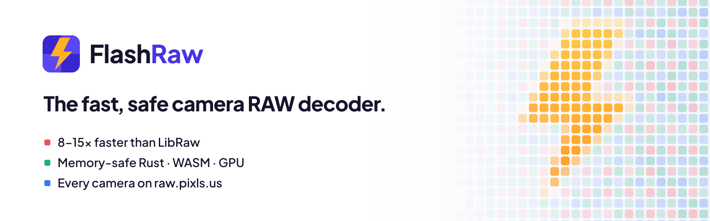
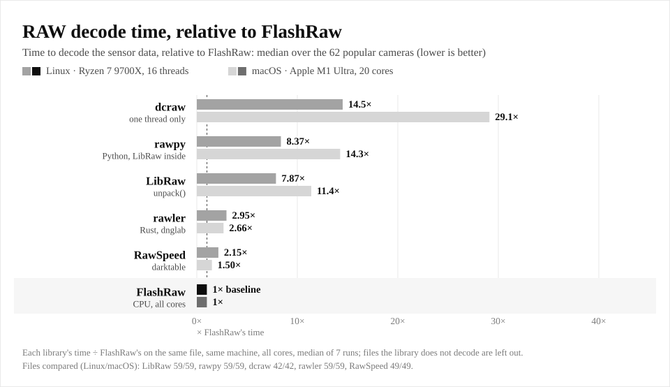
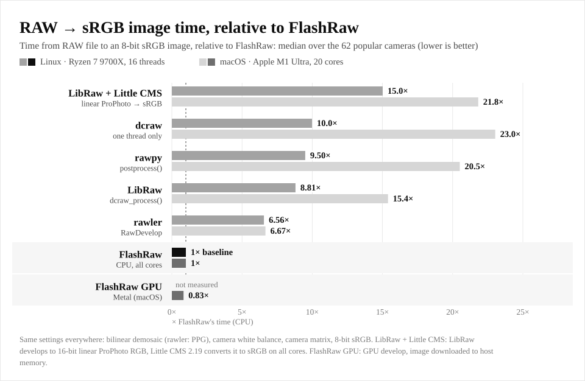
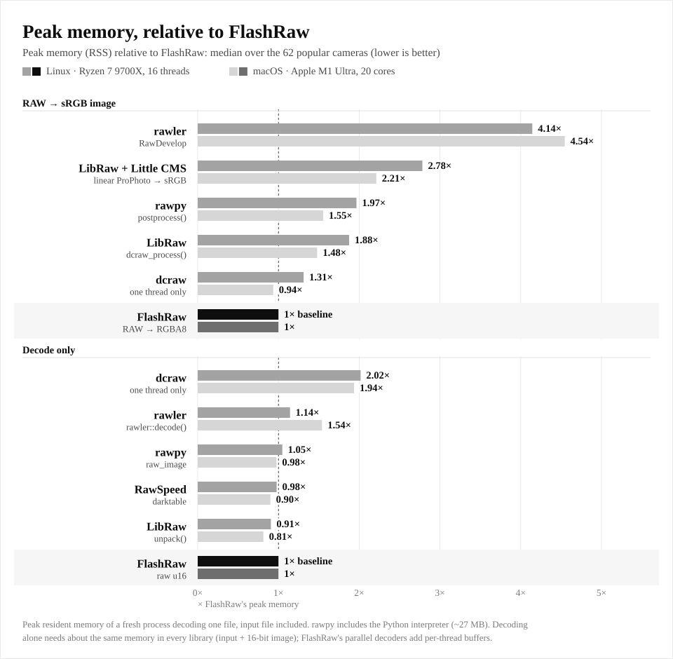
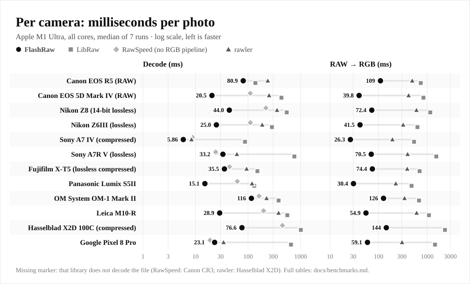

Built by **[@ybouane](https://x.com/ybouane)** · see also [LightFlow](https://lightflow.dev) ·
[ImageFlow](https://imageflow.dev)

# FlashRaw

[](https://flashraw.ybouane.com)

**The fast, safe camera RAW decoder.** **[▶ Live demo](https://flashraw.ybouane.com)**: open a
RAW file right in your browser.

Rust core · C, C++, Python and JavaScript bindings · SIMD, all cores and the GPU · runs in the browser

[](#-license)
[](#api-stability)

FlashRaw opens a camera RAW file and gives you the sensor data plus everything needed to
interpret it (CFA layout, black and white levels, white balance, colour matrices, crops,
orientation), the embedded previews, or a display-ready sRGB image. It handles every make and
model on raw.pixls.us, it is written in memory-safe Rust, and on the same machine as the other
open-source decoders it is **7.9×–11.4× faster than LibRaw** at decoding,
**8.8×–15.4× faster** at producing an sRGB image, and needs
**1.5×–1.9× less memory** for it (medians over 62 popular cameras).

## ⚡ FlashRaw vs the others

Median over the 62 bodies, phones and drones of
[`benches/popular-cameras.tsv`](benches/popular-cameras.tsv), each library on the files it can
decode, same files, same machine, all cores. **N× faster** = the other library's time ÷
FlashRaw's; **N× less memory** = the other library's peak memory ÷ FlashRaw's.

| FlashRaw compared with | 🐧 Linux · Ryzen 7 9700X | 🍎 macOS · Apple M1 Ultra |
|---|---:|---:|
| **Decode** (RAW → 16-bit sensor data) | | |
| vs LibRaw `unpack()` | **7.9× faster** | **11.4× faster** |
| vs RawSpeed (darktable) | **2.1× faster** | **1.5× faster** |
| vs rawler (dnglab, Rust) | **3.0× faster** | **2.7× faster** |
| vs rawpy (Python) | **8.4× faster** | **14.3× faster** |
| vs dcraw (single-threaded) | **14.5× faster** | **29.1× faster** |
| **RAW → sRGB image** (demosaic, white balance, colour, 8-bit sRGB) | | |
| vs LibRaw `dcraw_process()` | **8.8× faster** · 1.9× less memory | **15.4× faster** · 1.5× less memory |
| vs LibRaw + Little CMS (linear ProPhoto → sRGB) | **15.0× faster** · 2.8× less memory | **21.8× faster** · 2.2× less memory |
| vs rawler `RawDevelop` | **6.6× faster** · 4.1× less memory | **6.7× faster** · 4.5× less memory |
| vs rawpy `postprocess()` | **9.5× faster** · 2.0× less memory | **20.5× faster** · 1.6× less memory |
| vs dcraw (single-threaded) | **10.0× faster** · 1.3× less memory | **23.0× faster** · 1.1× more memory |
| ⚡ FlashRaw **GPU** (Metal) vs LibRaw `dcraw_process()` | – | **17.9× faster** |

<sub>Builds favour the others where possible (LibRaw and RawSpeed with OpenMP and `-O3`,
`-march=native` on x86-64; the Little CMS transform on all cores; dcraw has no threads). Every
number, the method, per-camera and per-format tables, one-thread results, and **the cases where
FlashRaw is not the fastest** (RawSpeed on some uncompressed and Sony lossless files, GoPro GPR;
LibRaw on some Canon CR3, rawler on the JPEG XL DNG) and **uses more memory** (a plain decode on all cores: FlashRaw's
parallel decoders keep per-thread buffers) are in [docs/benchmarks.md](docs/benchmarks.md).
Reproduce with [`tools/bench/compare.py`](tools/bench/compare.py).</sub>

<p align="center">
  
</p>
<p align="center">
  
</p>

### 🧠 Memory

<p align="center">
  
</p>

To produce an sRGB image FlashRaw develops in one fused pass (demosaic, white balance, colour
matrix and sRGB encoding per pixel, straight into the output), so it never holds the
full-size intermediate images of a classic pipeline: LibRaw keeps a 4-channel 16-bit working
image, the LibRaw + Little CMS pipeline adds a 16-bit RGB copy and the 8-bit output, rawler
develops in 32-bit floats. Decoding alone needs about the same memory everywhere (the file plus
a 16-bit image); with all cores FlashRaw's speculative parallel decoders add per-thread buffers,
so a plain all-core decode can take more memory than LibRaw's (details in
[docs/benchmarks.md](docs/benchmarks.md#memory)).

### 📷 Per camera

<p align="center">
  
</p>

## 🏭 Used in production

| | |
|---|---|
| **[LightFlow](https://lightflow.dev)** | Professional photo correction and colour grading, running locally in your browser with WebGPU |
| **[ImageFlow](https://imageflow.dev)** | A Photoshop-class image editor in your browser |

Both open camera RAW files with FlashRaw's WebAssembly package, right in the browser.

## ✨ Why FlashRaw

<table>
<tr>
<td width="33%" valign="top">

### ⚡ Speed

- **Every** decoder is multithreaded, even single-stream codecs (lossless JPEG, Nikon,
  Pentax, Hasselblad, Panasonic v8, Sony ARW1), by speculative parallel decoding
- Explicit SIMD: SSE4.1 / AVX2 / AVX-512, NEON and WASM SIMD128, picked at run time
- 64-bit bit pumps, table-driven Huffman, zero-copy parsing, memory-mapped input
- Fused single-pass RAW → RGB, on the CPU or the **GPU**, in sRGB, Display P3, Adobe RGB,
  ProPhoto or Rec. 2020 at no extra per-pixel cost (ICC-tagged, any ICC profile via `icc`)
- Region and tile decodes, zero-copy embedded previews: no full decode when you
  don't need one

</td>
<td width="33%" valign="top">

### 🛡️ Security

- **Memory-safe Rust**: parsers that read untrusted files cannot overflow buffers or
  use freed memory; the few `unsafe` blocks are audited and justified
- Bounds-checked parsing, checked offset arithmetic, IFD loop and depth tracking
- Allocation **limits** checked before allocating
- **11 fuzz targets** on every PR and nightly; crash inputs replayed forever
- Malformed-file and truncation suites, and an explicit **truncation policy**:
  never silent garbage

</td>
<td width="33%" valign="top">

### 📷 Support

- **~40 RAW formats**, every make and model on raw.pixls.us: 1,980 of 2,016 corpus
  files decode, with pinned output hashes
- **CR3** incl. C-RAW, **JPEG XL DNG**, lossy and deflate DNG, GoPro GPR, Sigma X3F,
  Fuji compressed, Panasonic v4–v8, IIQ, 3FR/FFF, …
- **GPU**: Metal, Vulkan, DX12 and **WebGPU**
- **Everywhere**: Rust, C, C++, Python, npm (browsers, Web Workers, Node)
- Linux, macOS, Windows · x86-64 and ARM64 · WebAssembly

</td>
</tr>
</table>

## 🆚 Feature comparison

| | ⚡ **FlashRaw** | LibRaw | RawSpeed | rawler / dnglab | dcraw | rawpy | Little CMS ¹ |
|---|:---:|:---:|:---:|:---:|:---:|:---:|:---:|
| What it is | RAW decoder + developer | RAW decoder + developer | RAW decoder (darktable) | RAW decoder + DNG converter | RAW converter program | Python binding of LibRaw | colour-management engine |
| Written in | 🦀 Rust | C++ | C++ | 🦀 Rust | C | Python + C++ (LibRaw) | C |
| Memory-safe | ✅ (a few audited `unsafe` blocks) | ❌ | ❌ | ⚠️ Rust, but it panics on bad input and advises against untrusted files | ❌ | ❌ | ❌ |
| Uses the GPU | ✅ Metal, Vulkan, DX12, WebGPU | ❌ | ❌ | ❌ | ❌ | ❌ | ❌ |
| Multithreading | ✅ every codec (speculative decoding of sequential streams) + develop | ⚠️ OpenMP builds: CR3, Fuji, Panasonic v8, some demosaics | ⚠️ OpenMP: tiled/sliced codecs | ✅ rayon: tiles, several codecs, develop | ❌ | ⚠️ as LibRaw; wheels: OpenMP on Linux/Windows, not macOS | ⚠️ one thread per transform (threaded plugin: GPL-3 or commercial) |
| Explicit SIMD | ✅ SSE4.1, AVX2, AVX-512, NEON, WASM SIMD128 | ❌ | ⚠️ one SSE2 routine | ⚠️ compiler multiversioning, no intrinsics | ❌ | ❌ | ⚠️ SSE2 in the fast_float plugin (GPL-3 or commercial) |
| Cameras | every make and model on raw.pixls.us (1,980 of 2,016 files), 1,000+ in its camera DB, any DNG | 1,284 (its own count) | ~920 make/model | ~850 make/model | ~570 colour profiles (last release 2018) | as LibRaw | – |
| Canon CR3 (incl. C-RAW) | ✅ | ✅ | ❌ | ✅ | ❌ | ✅ | – |
| JPEG XL DNG (DNG 1.7, e.g. Samsung Galaxy) | ✅ | ⚠️ Adobe DNG SDK builds only | ❌ | ✅ | ❌ | ❌ | – |
| GoPro GPR (VC-5) | ✅ | ⚠️ GPR SDK builds only | ✅ | ❌ | ❌ | ❌ | – |
| DNG opcode lists | ✅ all radiometric opcodes, per stage | ⚠️ Adobe DNG SDK builds only | ⚠️ stage-1 subset | ❌ | ⚠️ one opcode (lossy DNG) | ⚠️ as LibRaw | – |
| RAW → sRGB image | ✅ one fused pass, CPU or GPU | ✅ `dcraw_process()`, many demosaics | ❌ raw data only | ✅ `RawDevelop` | ✅ | ✅ `postprocess()` | ⚠️ converts colours, does not decode RAW |
| ICC colour management | ✅ built-in spaces (sRGB, P3, Adobe RGB, ProPhoto, Rec. 2020) + embedded profiles; any ICC v2/v4 profile via the `icc` feature | ⚠️ with Little CMS compiled in | ❌ | ❌ | ⚠️ with Little CMS | ⚠️ as LibRaw (Little CMS in the wheels) | ✅ ICC v2/v4 |
| Embedded previews | ✅ zero-copy | ✅ copied | ❌ | ⚠️ some formats, decoded | ✅ `-e` | ✅ `extract_thumb()` | – |
| Region / tile decode | ✅ | ❌ | ❌ | ❌ | ❌ | ❌ | – |
| C / C++ API | ✅ `flashraw.h`, `flashraw.hpp` | ✅ | ⚠️ C++ only | ❌ Rust only | ❌ command line only | ❌ | ✅ C |
| Python | ✅ official, NumPy zero-copy, releases the GIL | ⚠️ third-party (rawpy) | ❌ | ❌ | ❌ | ✅ | ⚠️ third-party |
| JavaScript / WASM, runs in the browser | ✅ official npm package (WASM SIMD, threads, WebGPU) | ⚠️ third-party ports | ❌ | ❌ | ⚠️ third-party ports | ❌ | ⚠️ third-party ports |
| Rust | ✅ native | ⚠️ third-party bindings | ❌ | ✅ native | ❌ | ❌ | ⚠️ third-party crate |
| LibRaw-compatible C API | ✅ subset (recompile and relink) | – | ❌ | ❌ | ❌ | – | – |
| Fuzzed | ✅ 11 in-tree targets, every PR + nightly | ✅ OSS-Fuzz | ✅ OSS-Fuzz + in-tree | ⚠️ 8 in-tree targets | ❌ | ⚠️ relies on LibRaw | ✅ OSS-Fuzz + in-tree |
| License | MIT / Apache-2.0 | LGPL-2.1 / CDDL-1.0 | LGPL-2.1+ | LGPL-2.1 | own licence (Foveon code: GPL-2+) | MIT (bundles LibRaw) | MIT |

<sub>¹ Little CMS is not a RAW decoder: it is compared as the colour-management stage of a
typical LibRaw-based pipeline (see the benchmarks above). Checked against the sources and docs
of LibRaw 0.22, RawSpeed (develop, c835b05), rawler 0.8.0, dcraw 9.28, rawpy 0.27.1 and Little
CMS 2.19.1 (October 2026). Camera counts are not directly comparable: LibRaw counts its own
way, the RawSpeed and rawler figures are unique make/model pairs in their camera lists, dcraw's
is the size of its colour table. Nikon High Efficiency (TicoRAW) is a proprietary codec no open
decoder supports.</sub>

## 🏁 Benchmarks: popular cameras

Milliseconds per file on an Apple M1 Ultra (20 cores, macOS), all cores, median of 7 runs,
lower is better, **bold** = fastest. *Decode* = open + full sensor decode to 16-bit samples.
*RAW → sRGB* = decode + demosaic + white balance + colour conversion to an 8-bit sRGB image
(RawSpeed has no RGB pipeline; LibRaw + Little CMS develops to linear ProPhoto RGB and converts
it with Little CMS). ❌ = not supported.

| Camera | Format · codec | MP | Decode<br>FlashRaw | LibRaw | RawSpeed | rawler | RAW → sRGB<br>FlashRaw | LibRaw | LibRaw +<br>Little CMS | rawler |
|---|---|---:|---:|---:|---:|---:|---:|---:|---:|---:|
| Canon EOS R5 (RAW) | CR3 · canon-crx | 47 | **80.9** | 138 | ❌ | 237 | **109** | 737 | 1104 | 492 |
| Canon EOS R6 Mark II (RAW) | CR3 · canon-crx | 25 | **45.7** | 76.9 | ❌ | 136 | **61.0** | 406 | 617 | 265 |
| Canon EOS 5D Mark IV (RAW) | CR2 · lossless-jpeg | 31 | **20.5** | 431 | 110 | 251 | **39.8** | 837 | 1100 | 415 |
| Nikon Z8 (14-bit lossless) | NEF · nikon-huffman | 46 | **44.0** | 544 | 218 | 356 | **72.4** | 1156 | 1542 | 601 |
| Nikon Z6III (lossless) | NEF · nikon-huffman | 24 | **25.0** | 285 | 110 | 186 | **41.5** | 629 | 824 | 320 |
| Nikon D850 (14-bit lossless) | NEF · nikon-huffman | 46 | **45.1** | 488 | 170 | 325 | **72.7** | 1102 | 1496 | 575 |
| Sony A7 IV (lossless) | ARW · sony-lossless | 37 | 19.2 | 414 | **11.7** | 38.7 | **40.8** | 870 | 1158 | 220 |
| Sony A7 IV (compressed) | ARW · sony-arw2 | 33 | **5.86** | 87.4 | 8.77 | 8.38 | **26.3** | 536 | 814 | 192 |
| Sony A7R V (lossless) | ARW · sony-lossless | 65 | 33.2 | 761 | **24.2** | 61.3 | **70.5** | 1538 | 2097 | 395 |
| Sony A1 (compressed) | ARW · sony-arw2 | 50 | **8.14** | 132 | 13.4 | 11.8 | **39.3** | 797 | 1220 | 283 |
| Fujifilm X-T5 (lossless compressed) | RAF · fuji-compressed | 41 | **35.5** | 151 | 44.4 | 93.9 | **74.4** | 697 | 1032 | 388 |
| Fujifilm X-H2 (compressed) | RAF · fuji-compressed | 41 | **46.5** | 173 | ❌ | 127 | **94.8** | 878 | 1203 | 420 |
| Fujifilm GFX100 II (lossless compressed) | RAF · fuji-compressed | 103 | **67.3** | 267 | 76.6 | 143 | **125** | 1569 | 2451 | 688 |
| Panasonic Lumix S5II | RW2 · panasonic-v8 | 24 | **15.1** | 131 | 62.4 | 119 | **30.4** | 477 | 686 | 226 |
| Panasonic Lumix GH6 | RW2 · panasonic-v8 | 25 | **17.0** | 133 | 63.5 | 117 | **32.9** | 498 | 718 | 232 |
| OM System OM-1 Mark II | ORF · olympus | 20 | **116** | 381 | 162 | 225 | **126** | 678 | 846 | 341 |
| Pentax K-3 Mark III | PEF · pentax-huffman | 27 | **29.8** | 204 | 83.6 | 174 | **48.2** | 562 | 772 | 321 |
| Ricoh GR III | DNG · lossless-jpeg | 25 | **18.1** | 316 | 96.2 | 214 | **34.1** | 659 | 864 | 343 |
| Leica Q2 | DNG · uncompressed | 47 | **4.04** | 293 | 49.2 | 4.54 | **33.1** | 926 | 1324 | 259 |
| Leica M10-R | DNG · lossless-jpeg | 41 | **28.9** | 559 | 197 | 381 | **54.9** | 1085 | 1456 | 605 |
| Hasselblad X2D 100C (compressed) | FFF · hasselblad | 105 | **76.6** | 1013 | 451 | ❌ | **144** | 2316 | 3204 | ❌ |
| Phase One IQ4 150MP (IIQ L) | IIQ · phaseone | 154 | **42.1** | 1006 | ❌ | 341 | **133** | 4305 | 5692 | 952 |
| Sigma fp L | DNG · lossless-jpeg | 60 | 28.0 | 761 | **22.4** | 40.9 | **72.1** | 1566 | 2081 | 364 |
| Apple iPhone 12 Pro (ProRAW) | DNG · lossless-jpeg | 12 | **15.4** | 469 | ❌ | 27.8 | **24.3** | 592 | 688 | 74.4 |
| Google Pixel 8 Pro | DNG · lossless-jpeg | 50 | 23.1 | 656 | **18.9** | 34.2 | **59.1** | 1446 | 1891 | 303 |
| Samsung Galaxy S23 Ultra | DNG · lossless-jpeg | 50 | **129** | 1916 | 550 | 1135 | **178** | 2194 | 2507 | 1292 |
| Samsung Galaxy S22 (JPEG XL) | DNG · jpeg-xl | 12 | 272 | ❌ | ❌ | **173** | 289 | ❌ | ❌ | **212** |
| DJI Phantom 4 Pro | DNG · uncompressed | 20 | 1.22 | 17.0 | **0.99** | 1.36 | **18.9** | 292 | 474 | 117 |
| GoPro HERO11 Black (GPR) | DNG · gopro-vc5 | 27 | 39.8 | ❌ | **18.5** | ❌ | **60.2** | ❌ | ❌ | ❌ |

The full list (62 bodies, phones, drones and action cameras), the same tables on Linux x86-64,
rawpy and dcraw, single-thread results, GPU timings, peak memory per camera and per-format
results are in [docs/benchmarks.md](docs/benchmarks.md). Reproduce everything with
[`tools/bench/compare.py`](tools/bench/compare.py); the charts come from
[`tools/bench/charts.py`](tools/bench/charts.py) and their numbers are in
[`docs/charts/data.json`](docs/charts/data.json).

## 🛡️ Security

RAW files are untrusted input: they come from the web, from email, from memory cards. FlashRaw
is built for that.

- ✅ **Memory-safe Rust.** Parsing and decoding are safe Rust. `unsafe` is confined to SIMD
  intrinsics, zeroed allocation, a disjoint-tile writer, the input self-reference, the WASM
  clock hook and the mmap call, each with a `SAFETY:` justification and tests
  ([architecture](docs/architecture.md)).
- ✅ **Fuzzed continuously.** Eleven cargo-fuzz targets (the whole open/decode pipeline over every
  format under both corruption policies, TIFF and BMFF parsers, bit pumps against a model,
  Huffman, lossless JPEG, packed unpack, deflate/float, DCT, DNG opcodes) run on every PR and
  for 15 minutes each nightly. Every crash input is kept and replayed.
- ✅ **Malformed-file suite.** Truncation at every cut point, invalid offsets and counts,
  recursive IFDs, overflowing dimensions, broken Huffman tables, corrupted entropy data,
  garbage behind every magic number, and mutations of a real file of every extension: each
  must finish without panicking within a time bound ([testing](docs/testing.md)).
- ✅ **Resource limits.** Image sizes are checked against `Limits` (samples, dimensions)
  *before* anything is allocated, so a 20-byte file cannot ask for 64 GB.
- ✅ **No silent garbage.** Sensor data that runs past the end of the file is recovered with
  structured warnings or rejected, as you choose (see
  [truncated and corrupt sensor data](#truncated-and-corrupt-sensor-data)).
- ✅ **Sandboxable.** The npm package runs the decoder inside WebAssembly: a decoder bug cannot
  corrupt the host process.

## 📷 Supported formats, cameras and platforms

| | |
|---|---|
| **Formats** | DNG (uncompressed, lossless JPEG, deflate int/float, lossy JPEG, **JPEG XL**, GoPro VC-5, Blackmagic), CR2 (incl. sRAW/mRAW), **CR3** (CRX and C-RAW), CRW, NEF/NRW, ARW/SR2/SRF/ARQ, RAF (incl. compressed X-Trans), RW2/RWL (Panasonic v4–v8), ORF/ORI, PEF, SRW, MRW, IIQ, MOS, 3FR/FFF, KDC/DCR/DCS, ERF, MEF, X3F, ARI, headerless and CHDK raws |
| **Cameras** | every make and model on raw.pixls.us (1,980 of 2,016 files decode), 1,000+ models in the built-in camera database, and DNG from any camera, phone or drone |
| **Not supported** | Nikon High Efficiency (proprietary TicoRAW codec) and a few rare variants: see [formats](docs/formats.md) |
| **Outputs** | raw `u16` / `f32`, normalised `f32`, linear RGB `f32`, display RGBA8 (bilinear or half-size demosaic, as-shot white balance, colour matrix, sRGB, orientation), GPU-resident textures |
| **GPU** | wgpu: Metal, Vulkan and DX12 natively, WebGPU in browsers; `Backend::Auto` uses the GPU only where it measures a win ([GPU](docs/gpu.md)) |
| **Languages** | Rust, C, C++, Python, JavaScript/TypeScript, plus a LibRaw-compatible C API |
| **Platforms** | Linux, macOS, Windows (x86-64, ARM64); WebAssembly in Chrome, Edge, Firefox and Safari, Web Workers and Node.js, multithreaded where the page is cross-origin isolated |

Support is tracked per format *and mode* (`verified`, `partial`, `experimental`,
`unsupported`): see [docs/formats.md](docs/formats.md) or run `flashraw supported`.

## 🚀 Quick start

### 🦀 Rust

```toml
[dependencies]
flashraw = "0.1"
```

```rust
use flashraw::{FlashRaw, DecodeOptions, Backend, OutputFormat};

fn main() -> flashraw::Result<()> {
    let raw = FlashRaw::open_path("photo.NEF")?;          // memory-mapped, headers only

    let m = raw.metadata();
    println!("{} {}x{} ISO {:?}", m.camera(), m.width, m.height, m.exposure.iso);

    // Embedded JPEG preview, zero-copy, without decoding the RAW payload:
    if let Some(p) = raw.preview() {
        std::fs::write("preview.jpg", raw.preview_bytes(p)?)?;
    }

    // Sensor data:
    let frame = raw.decode(DecodeOptions {
        backend: Backend::Auto,
        output: OutputFormat::RawU16,
        ..Default::default()
    })?;
    println!(
        "{}x{} CFA {:?} black {:?} white {:?} via {}",
        frame.width(), frame.height(), frame.cfa, frame.black_level.values,
        frame.white_level.values, frame.stats().backend.decode
    );

    // Display-ready RGBA8 (bilinear demosaic, as-shot WB, colour matrix, sRGB, orientation):
    let rgba = raw.decode(DecodeOptions { output: OutputFormat::Rgba8, ..Default::default() })?;
    Ok(())
}
```

Input sources: `FlashRaw::open(&[u8])` (zero-copy borrow), `open(Vec<u8>)`,
`open(Arc<[u8]>)`, `open(memmap2::Mmap)`, `open_path(path)`, `from_reader(reader)`.

Other entry points: `decode_region(rect, opts)`, `decode_tile(index, opts)`,
`units()` (independently decodable tiles/strips with byte ranges),
`capabilities()`, `previews()` / `thumbnail()` / `decode_preview_rgb()`,
`flashraw::read_metadata(bytes)`, `flashraw::supports(bytes)`.

Output formats: `RawU16` (default), `RawF32`, `NormalizedF32` (black-subtracted,
white-scaled), linear sRGB-primaries RGB as `LinearRgbF32`, `LinearRgbF16` (half floats,
half the memory) or `LinearRgb16`, and display-ready sRGB as `Rgba8` or `Rgb16` (16-bit,
orientation applied). RGB outputs take `exposure` (EV) and `black_point` / `white_point`
convenience controls. Statistics (`frame.stats()`) report per-stage timings and the
backend that ran.

### 🐍 Python

```sh
pip install flashraw
```

```python
import flashraw

with flashraw.open("photo.NEF") as raw:
    print(raw.metadata.camera.name, raw.metadata.exposure.iso)
    sensor = raw.decode().array                  # numpy uint16 (h, w), zero-copy
    rgba = raw.decode(output="rgba8").array      # numpy uint8 (h, w, 4), display-ready
```

Decoding releases the GIL, so Python threads decode files in parallel. See
[docs/python.md](docs/python.md).

### 🌐 Browser and Node.js (npm)

```js
import { FlashRaw } from "flashraw";

const buffer = await (await fetch("/photo.CR3")).arrayBuffer();
const raw = await FlashRaw.open(buffer);

console.log(raw.metadata.camera, raw.metadata.width, raw.metadata.height);
const preview = await raw.preview();                      // embedded JPEG, instantly
const frame = await raw.decode({ backend: "auto", output: "raw-u16" });
console.log(frame.width, frame.height, frame.cfa, frame.backend, frame.timings);

const img = await raw.decode({ output: "rgba8" });
ctx.putImageData(new ImageData(img.data, img.width, img.height), 0, 0);
raw.close();
```

See [npm/README.md](npm/README.md) for Node, React/Vite, Web Workers, metadata-only,
preview extraction, GPU and CPU fallback examples, and [docs/wasm.md](docs/wasm.md).

### 🔧 C

```c
#include <flashraw.h>

flashraw_file *f = NULL;
if (flashraw_open_path("photo.NEF", NULL, &f) != FLASHRAW_OK) {
    fprintf(stderr, "%s\n", flashraw_last_error_message());
    return 1;
}
flashraw_decode_options o;
flashraw_decode_options_init(&o);
o.output = FLASHRAW_OUTPUT_RGBA8;
flashraw_frame *fr = NULL;
if (flashraw_decode(f, &o, &fr) == FLASHRAW_OK) {
    const uint8_t *rgba = flashraw_frame_data(fr);  /* width x height x 4 bytes */
    flashraw_frame_free(fr);
}
flashraw_file_free(f);
```

### ➕ C++

```cpp
#include <flashraw.hpp>

flashraw::file raw = flashraw::file::open("photo.CR3");   // throws flashraw::error
flashraw::decode_options o;
o.output = flashraw::output_format::linear_rgb_f32;
flashraw::frame img = raw.decode(o);
flashraw::span<const float> rgb = img.f32();             // no copy
```

Build with `cargo build --release -p flashraw-capi` or install with CMake (`find_package(flashraw)`,
pkg-config). See [docs/c-api.md](docs/c-api.md).

### 🔁 Coming from LibRaw?

`flashraw-libraw-compat` implements the commonly used part of the LibRaw C API
(`libraw_init`, `libraw_open_file`, `libraw_unpack`, `libraw_dcraw_process`,
`libraw_dcraw_make_mem_image`, …) on top of FlashRaw. Keep your `#include <libraw/libraw.h>`,
recompile against its headers and link `-lraw` from FlashRaw. See
[docs/libraw-compat.md](docs/libraw-compat.md) for the supported subset and deviations.

### 💻 CLI

```sh
cargo install --path crates/flashraw-cli

flashraw info photo.CR3                     # summary (--json for machine output)
flashraw dump-metadata photo.ARW            # everything, as JSON
flashraw decode photo.NEF out.raw           # raw u16 samples (.pgm/.tiff also supported)
flashraw decode photo.RAF out.jpg --output rgba8 --profile
flashraw decode photo.DNG tile.pgm --tile 12
flashraw decode photo.DNG crop.pgm --region 1000,800,512,512
flashraw preview photo.CR2 preview.jpg      # embedded full-size JPEG
flashraw thumbnail photo.CR2 thumb.jpg
flashraw benchmark photo.NEF --iterations 10 --threads 8
flashraw verify photo.ORF --json            # geometry, levels and full-buffer hashes
flashraw verify cut.DNG --json --strict     # fail on truncated data (default: recover + warnings)
flashraw supported                          # format/mode support matrix
flashraw camera-db validate|generate|compare|stats
```

Options: `--backend auto|cpu|simd|gpu`,
`--output raw-u16|raw-f32|normalized|linear-rgb|linear-rgb16|linear-rgb-f16|rgba8|rgb16`,
`--region x,y,w,h`, `--tile N`, `--threads N`, `--demosaic bilinear|half`,
`--exposure EV`, `--black-point V`, `--white-point V`, `--profile`, `--json`.

```
$ flashraw decode photo.DNG out.jpg --output rgba8 --profile
Container parse:             0.05 ms
Pixel unpack:                4.75 ms
Post-process:               28.82 ms
Total:                      34.85 ms

Backend:
  decode: CPU SSE4.1 x16 threads
  postprocess: CPU x16
```

## 📚 Reference

### Truncated and corrupt sensor data

A strip, tile or other sensor-data range that runs past the end of the file is never
silently zero-filled. `DecodeOptions::corruption_policy` decides what happens:

- `CorruptionPolicy::Recover` (default): every complete sample is decoded, missing ones
  are zero, and the frame says so: `frame.is_incomplete()` and `frame.warnings()`, each a
  `DecodeWarning` with the unit (strip/tile index), the bytes expected and available and
  the samples filled ("recovered truncated strip 17: 48291 / 131072 bytes available;
  41390 missing samples were zero-filled").
- `CorruptionPolicy::Strict`: the decode fails with `Error::CorruptFile`; `e.truncation()`
  (or `e.corrupt_reason()`) gives the same details ("truncated image data: strip 17
  expected 131072 bytes at offset 24576000, but only 48291 bytes remain before EOF").
  `e.kind()` stays `"CorruptFile"`.

Only the data a decode needs is checked: metadata, previews and region decodes that do
not touch the missing data work normally. Short data that still holds every sample is
complete: the last row needs no padding to the row stride, and a declared length beyond
the last needed sample may run past the end of the file. Recovery covers uncompressed
and bit-packed payloads in every format and compressed DNG strips/tiles (a unit that is
truncated or fails to decode is zero-filled with a warning), and Nikon and Pentax Huffman
and Samsung SRW streams cut short by the end of the file (the rows decoded from real data
are kept). Other compressed streams (one entropy-coded stream per image) fail under both
policies; when their declared range runs past the end of the file the error carries the
same truncation details. A file cut inside its directory structure, before the raw image's
IFD, fails with `Error::CorruptFile`: a thumbnail or preview is never decoded in place of
the sensor image.

### Undecodable sensor data

Sensor data in a codec FlashRaw cannot decode (Nikon High Efficiency NEF) fails with
`Error::UnsupportedCompression`, also for RGB outputs. With
`DecodeOptions::preview_fallback`, `Rgba8` and `LinearRgbF32` decodes return the embedded
full-size preview instead, explicitly marked: `frame.source == FrameSource::Preview` and a
`DecodeWarning` whose reason is `CorruptReason::PreviewFallback`. Such a frame is the
camera's 8-bit rendering, not sensor data; raw outputs and regions never fall back. The
CLI (`--preview-fallback`), JavaScript (`previewFallback`), Python (`preview_fallback=`)
and C (`flashraw_decode_options.preview_fallback`, `flashraw_frame_source()`) expose the
same option.

### GPU

Build with `--features gpu`. Packed/uncompressed payloads are unpacked on the GPU;
black subtraction, demosaic, white balance, colour conversion and sRGB encoding run
as WGSL compute shaders shared by native (Vulkan/Metal/DX12) and browser (WebGPU)
builds; results can stay GPU-resident. `Backend::Auto` only picks the GPU when its
measured cost model predicts a win. See [docs/gpu.md](docs/gpu.md).

### API stability

FlashRaw follows semver. The public API is everything documented at the crate root:
`FlashRaw`, `Source`, `DecodeOptions` and its enums, `RawFrame`, the metadata types,
`Error`, and the `gpu` module (feature `gpu`).

- Enums that can gain variants (formats, compressions, outputs, backends, errors,
  stages, preview kinds, ...) are `#[non_exhaustive]`: match them with a wildcard arm.
- Result and metadata structs (`RawFrame`, `RawMetadata`, `FrameInfo`,
  `DecodeStatistics`, `Limits`, ...) are `#[non_exhaustive]`: read their fields; build
  `Limits` with `Limits::default().with_max_samples(..)`.
- Build `DecodeOptions` with `..Default::default()` (new options are added as fields
  with backwards-compatible defaults, e.g. `corruption_policy`).
- `Error::CorruptFile` and its structured cause (`CorruptReason`, `Truncation`,
  `DataUnit`) and `DecodeWarning` are `#[non_exhaustive]`; read them through their
  fields and `Error::truncation()` / `Error::corrupt_reason()`.
- `Backend`, `OutputFormat`, `Demosaic` and `CorruptionPolicy` implement
  `FromStr`/`Display` with the names the CLI and the JS bindings use.
- Minimum supported Rust version: 1.85 for the library with default features and
  `serde`; 1.87 with `gpu` (and for the CLI and WASM crates); 1.88 with `jpegxl`.
  Raising it is a minor-version change.
- Hidden items (`low_level`, `process`, `decode_raw_image`) expose internals for
  tooling and carry no stability guarantee.

### Cargo features

| feature | default | effect |
|---|---|---|
| `rayon` | yes | multithreaded decoding |
| `simd` | yes | explicit SIMD kernels (runtime dispatch on x86-64) |
| `mmap` | yes | memory-mapped `open_path` |
| `gpu` | no | wgpu backend (Vulkan / Metal / DX12 / WebGPU) |
| `jpegxl` | no | JPEG XL compressed DNG (DNG 1.7) |
| `icc` | yes | arbitrary ICC output profiles (`DecodeOptions::output_profile`); the built-in colour spaces and their profiles need no feature. Every feature and dependency: [docs/building.md](docs/building.md) |
| `serde` | no | `Serialize` for metadata types |

## 📖 Documentation

[Architecture](docs/architecture.md) · [Formats](docs/formats.md) ·
[Building and features](docs/building.md) · [Colour management](docs/color-management.md) ·
[Benchmarks](docs/benchmarks.md) · [GPU](docs/gpu.md) · [WASM](docs/wasm.md) ·
[C and C++ API](docs/c-api.md) · [LibRaw-compatible API](docs/libraw-compat.md) ·
[Python](docs/python.md) · [Testing](docs/testing.md) · [Profiling](docs/profiling.md) ·
[Camera DB](docs/camera-db.md) · [Contributing](docs/contributing.md) ·
[References](docs/references.md)

## 📄 License

Code and data (including `crates/flashraw-camera-db/data/`): MIT OR Apache-2.0, at your option. See
[LICENSE-MIT](LICENSE-MIT) and [LICENSE-APACHE](LICENSE-APACHE).

---

<p align="center">
  <a href="https://flashraw.ybouane.com"></a><br>
  <sub>Built by <a href="https://x.com/ybouane"><b>@ybouane</b></a> · <a href="https://flashraw.ybouane.com">Live demo</a> ·
  used in <a href="https://lightflow.dev">LightFlow</a> and <a href="https://imageflow.dev">ImageFlow</a></sub>
</p>
