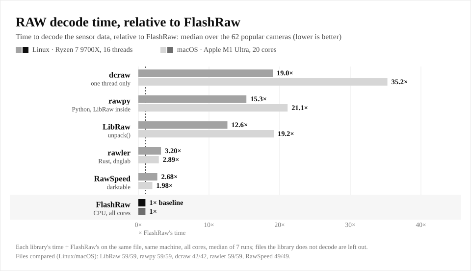
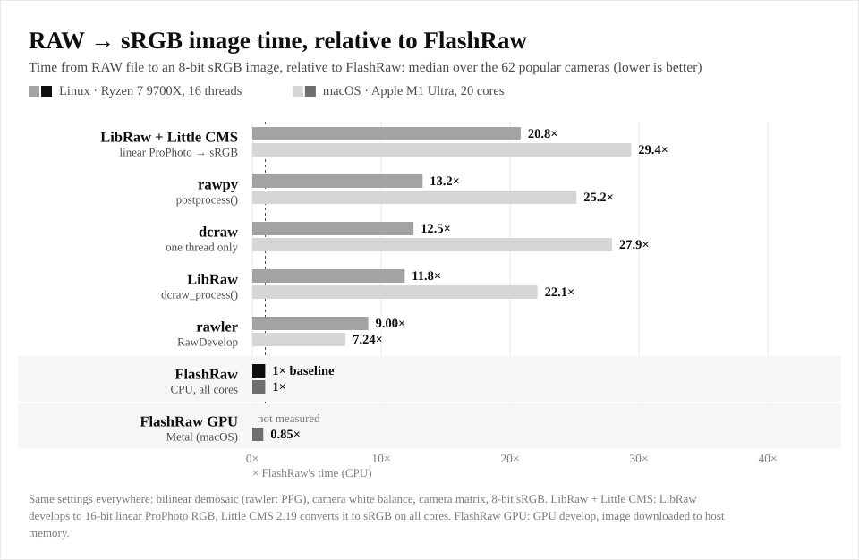
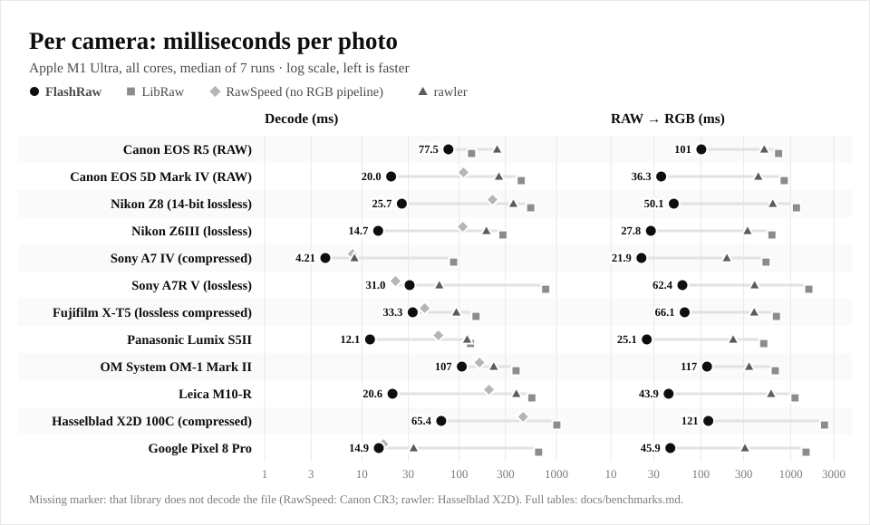
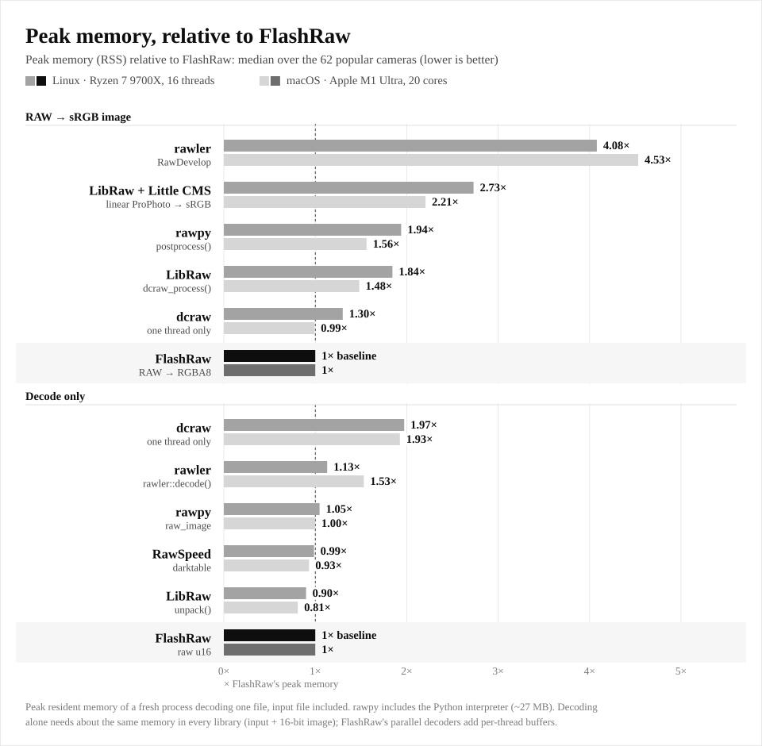

# Benchmarks

Every number here was measured on real camera files with the tools in this repository, and
can be reproduced with them. FlashRaw is compared, on the same files and the same machines,
with the open-source RAW decoders people use today, each built from source (or installed the
way its users install it):

- [LibRaw](https://www.libraw.org/), the most widely used RAW library (C++), decode and its
  `dcraw_process()` development to RGB;
- the **LibRaw + [Little CMS](https://www.littlecms.com/)** pipeline: LibRaw develops to a
  linear wide-gamut image and the Little CMS colour-management engine converts it to sRGB, the
  usual way to get colour-managed output from LibRaw (Little CMS is not a RAW decoder: it is
  measured as that pipeline's colour stage);
- [RawSpeed](https://github.com/darktable-org/rawspeed), darktable's decoder (C++, raw data
  only);
- [rawler](https://crates.io/crates/rawler), the Rust decoder of
  [dnglab](https://github.com/dnglab/dnglab), decode and its `RawDevelop` pipeline;
- [rawpy](https://github.com/letmaik/rawpy), the Python binding of LibRaw (what a Python user
  gets from `pip install rawpy`);
- [dcraw](https://www.dechifro.org/dcraw/), the C program LibRaw grew out of.

## Headline

Median speedup of FlashRaw over the 62 files of
[`benches/popular-cameras.tsv`](../benches/popular-cameras.tsv) (other library's time ÷
FlashRaw's on the same file; > 1 = FlashRaw faster), its geometric mean, and the number of
files where FlashRaw is faster, out of the files both decode. dcraw has no threads: its
one-thread time is used in the all-cores rows.

| Comparison | threads | 🐧 median | 🐧 geomean | 🐧 FlashRaw faster | 🍎 median | 🍎 geomean | 🍎 FlashRaw faster |
|---|---|---:|---:|---:|---:|---:|---:|
| decode vs LibRaw | all | **12.6×** | 7.78× | 58/59 | **19.2×** | 11.4× | 59/59 |
| decode vs LibRaw | 1 | **3.43×** | 2.87× | 59/59 | **2.08×** | 2.50× | 59/59 |
| decode vs RawSpeed | all | **2.68×** | 2.71× | 48/49 | **1.98×** | 2.72× | 43/49 |
| decode vs RawSpeed | 1 | **1.45×** | 1.57× | 49/49 | **1.06×** | 1.13× | 31/49 |
| decode vs rawler | all | **3.20×** | 3.26× | 58/59 | **2.89×** | 3.89× | 58/59 |
| decode vs rawler | 1 | **1.90×** | 2.05× | 58/59 | **1.99×** | 1.92× | 58/59 |
| decode vs rawpy | all | **15.3×** | 8.45× | 58/59 | **21.1×** | 17.4× | 59/59 |
| decode vs rawpy | 1 | **3.51×** | 3.11× | 59/59 | **2.05×** | 2.60× | 59/59 |
| decode vs dcraw | all | **19.0×** | 19.0× | 42/42 | **35.2×** | 39.7× | 42/42 |
| decode vs dcraw | 1 | **4.84×** | 5.02× | 42/42 | **5.08×** | 5.99× | 42/42 |
| RAW→RGB vs LibRaw | all | **11.8×** | 9.61× | 59/59 | **22.1×** | 17.0× | 59/59 |
| RAW→RGB vs LibRaw | 1 | **2.41×** | 2.23× | 59/59 | **2.06×** | 2.04× | 59/59 |
| RAW→sRGB vs LibRaw + Little CMS | all | **20.8×** | 18.4× | 59/59 | **29.4×** | 23.6× | 59/59 |
| RAW→sRGB vs LibRaw + Little CMS | 1 | **15.0×** | 14.5× | 59/59 | **12.8×** | 12.8× | 59/59 |
| RAW→RGB vs rawler | all | **9.00×** | 7.92× | 59/59 | **7.24×** | 7.00× | 58/59 |
| RAW→RGB vs rawler | 1 | **5.49×** | 5.16× | 58/59 | **4.44×** | 4.22× | 58/59 |
| RAW→RGB vs rawpy | all | **13.2×** | 10.6× | 59/59 | **25.2×** | 20.9× | 59/59 |
| RAW→RGB vs rawpy | 1 | **2.69×** | 2.47× | 59/59 | **2.09×** | 2.09× | 59/59 |
| RAW→RGB vs dcraw | all | **12.5×** | 11.6× | 42/42 | **27.9×** | 24.6× | 42/42 |
| RAW→RGB vs dcraw | 1 | **2.39×** | 2.22× | 42/42 | **2.47×** | 2.35× | 42/42 |
| RAW→RGB, FlashRaw GPU vs LibRaw | all | – | – | – | **25.3×** | 19.7× | 52/52 |

<p align="center"></p>
<p align="center"></p>
<p align="center"></p>

- **With all cores FlashRaw is the fastest decoder on almost every file.** It decodes in
  parallel even the codecs whose data is one sequential stream (lossless JPEG, Nikon, Pentax,
  Hasselblad, Panasonic v8, Sony ARW1), which the others decode on one thread; LibRaw
  parallelises only its CR3, Fuji-compressed and Panasonic v8 decoders.
- **RAW → sRGB is where the gap is largest**: FlashRaw develops in one fused, multithreaded
  pass, where LibRaw (and rawpy, which is LibRaw), dcraw and rawler run several full-image
  passes (LibRaw's and dcraw's mostly on one thread). Colour management with Little CMS adds yet another full-image
  pass to a LibRaw pipeline (see [the stages](#libraw--little-cms-pipeline)).
- **On one thread the decoders are much closer**: on the Ryzen FlashRaw is faster than RawSpeed on
  49 of the 49 popular cameras both decode, on the M1 Ultra only on 31 of 49 (the median is 1.06×), where RawSpeed is
  often as fast or faster; see [where FlashRaw is not the fastest](#where-flashraw-is-not-the-fastest).
- Charts: [`charts/`](charts/) (generated by [`tools/bench/charts.py`](../tools/bench/charts.py),
  numbers in [`charts/data.json`](charts/data.json)). Raw data and the full per-machine
  reports: [`benches/results/`](../benches/results/).

## What is measured

| Library | Version, build | decode | RAW → RGB |
|---|---|---|---|
| **FlashRaw** | this repository, version 0.3.1 (commit `61c32fb`), `cargo build --release -p flashraw-cli --features jpegxl` (+ `gpu` on macOS) | `flashraw benchmark --output raw-u16 --backend simd`: open + full sensor decode to 16-bit samples, CPU | `--output rgba8 --demosaic bilinear --backend simd` (bilinear pinned; the default is `auto`): decode + bilinear demosaic + as-shot WB + colour matrix + sRGB 8-bit RGBA + orientation, one fused pass |
| **FlashRaw GPU** (macOS) | same, `--features gpu` | – | `--backend gpu --output rgba8`: CPU decode (or GPU unpack for packed data), Metal develop, image downloaded to host memory |
| **LibRaw** | 0.22.0, its `Makefile.dist`, `-O3` (+ `-march=native` on x86-64), zlib; all cores = OpenMP build, 1 thread = default build | `open_buffer()` + `unpack()` | + `dcraw_process()` (`user_qual=0` bilinear, `use_camera_wb=1`, `output_bps=8`, sRGB) + `dcraw_make_mem_image()` |
| **LibRaw + Little CMS** | LibRaw as above + Little CMS 2.19.1 (static, `-O3`) | – | LibRaw `unpack()` + `dcraw_process()` to **16-bit linear ProPhoto RGB** (bilinear, camera WB, `gamm = 1, 1`, `no_auto_bright`) + `dcraw_make_mem_image()`, then an lcms2 transform (linear ProPhoto → sRGB IEC 61966-2.1, perceptual, `TYPE_RGB_16` → `TYPE_RGBA_8`); profiles and transform created per image. All cores: the transform runs over 32-row blocks with OpenMP (a shared transform is reentrant); 1 thread: one `cmsDoTransform` call |
| **RawSpeed** | develop `c835b05`, CMake Release, `WITH_OPENMP=ON`, `WITH_JPEG=OFF` (+ `-march=native` on x86-64) | `RawParser::getDecoder()` + `checkSupport()` + `decodeRaw()` + `decodeMetaData()` | no RGB pipeline |
| **rawler** (dnglab) | 0.8.0 from crates.io, `cargo build --release`, rayon | `rawler::decode()` of an in-memory source: sensor data + metadata | + `RawDevelop::default().develop_intermediate()` (scaling, **PPG** demosaic, WB, camera matrix, crop, sRGB gamma, `f32`) + conversion to 8-bit RGB |
| **rawpy** | 0.27.1 wheel from PyPI (bundles LibRaw 0.22.1), CPython 3.13 (Linux), 3.9 (macOS) | `rawpy.imread(BytesIO)` + `raw_image` (`unpack`) | + `postprocess(demosaic_algorithm=LINEAR, use_camera_wb=True, output_bps=8)` |
| **dcraw** | 9.28, `cc -O3 -DNODEPS` (+ `-march=native` on x86-64), one thread (it has no threading) | `dcraw -c -D -4 FILE > /dev/null` (raw sensor values written as 16-bit PGM) | `dcraw -c -q 0 -w FILE > /dev/null` (bilinear, camera WB, 8-bit sRGB PPM) |

- Every value is the **median of 7 timed runs after one warm-up**, in a **fresh process per
  (file, library, mode, thread count)**. The input file is read into memory before timing
  (RawSpeed gets a padded copy, as its own reader provides) — except dcraw, a program rather
  than a library: each of its runs is a whole process (start-up, reading the file from the page
  cache, writing the image to `/dev/null`), so its times include a few ms the others do not pay.
- **Memory** is the peak resident set size (`ru_maxrss`) of that process: the input file held
  in memory, the library's working buffers and its output. The process decodes one file 8
  times in a row, freeing everything between decodes, so the peak is that of one decode. rawpy
  includes the Python interpreter and NumPy (about 27 MB before anything is decoded).
- **All cores** = each library's default parallelism: FlashRaw's thread pool, OpenMP for
  LibRaw, RawSpeed and the lcms2 transform, rayon for rawler; rawpy's wheels use OpenMP on
  Linux but not on macOS. **One thread**: `RAYON_NUM_THREADS=1`, `OMP_NUM_THREADS=1`, LibRaw's
  default build. dcraw runs on one thread in both columns.
- Files a library does not decode (error, or unsupported format) are left out of its
  comparisons. dcraw 9.28 "succeeds" on some files it cannot decode and writes an all-zero
  image (Canon CR3, whose decoder is an empty stub, and the Fujifilm compressed RAFs of current
  bodies): the script checks dcraw's output and counts those files as unsupported.

### What the outputs are

The libraries do not produce byte-identical results, so the comparison is of equivalent work,
not identical output:

- **decode**: every library decodes the full sensor buffer. FlashRaw and LibRaw report it
  whole, masked (optical black) borders included; RawSpeed reports a view cropped to the
  camera's active area. All return black/white levels and white balance. FlashRaw applies DNG
  opcode lists by default (bad pixels, gain maps, …); RawSpeed applies a subset of list 1, the
  others none.
- **RAW → sRGB**: FlashRaw, LibRaw, rawpy and dcraw demosaic bilinearly with the camera white
  balance and convert to 8-bit sRGB; rawler uses its PPG demosaic (more work than bilinear)
  in 32-bit floats. LibRaw, rawpy and dcraw also run an automatic-brightness histogram and
  write 3-channel RGB with a BT.709-style gamma; FlashRaw writes RGBA with the sRGB curve,
  applies DNG opcode list 3 and the orientation. The LibRaw + Little CMS pipeline skips the
  auto-brightness (it develops linear data) and writes RGBA, like FlashRaw.

## Reproducing

```sh
python3 tools/corpus/fetch.py                        # CC0 corpus (raw.pixls.us)
cargo build --release -p flashraw-cli --features jpegxl     # add gpu for the GPU column

# FlashRaw alone (regression tracking):
python3 tools/bench/run.py benches/benchmark-set.tsv --iterations 5 \
    --out benches/results/<host>.jsonl --markdown benches/results/<host>.md

# Against the other libraries: see the header of tools/bench/compare.py for how to get and
# build them (nothing is vendored); then
tools/bench/compare.py build --libraw-src <LibRaw> --rawspeed-src <rawspeed> --rawspeed-build <build> \
    --lcms-src <Little-CMS> --dcraw-src <dcraw.c> --rawler-version 0.8.0 --rawpy rawpy==0.27.1
tools/bench/compare.py run benches/popular-cameras.tsv \
    --libs flashraw libraw rawspeed rawler rawpy dcraw lcms --out pass1.jsonl [--max-busy 0.15]
tools/bench/compare.py run benches/benchmark-set.tsv --libs flashraw libraw rawspeed --out set.jsonl
tools/bench/compare.py merge pass1.jsonl pass2.jsonl set.jsonl --out benches/results/<host>-compare.jsonl
tools/bench/compare.py report benches/results/<host>-compare.jsonl --popular benches/popular-cameras.tsv \
    --markdown benches/results/<host>-compare.md
tools/bench/charts.py                                # docs/charts/*.svg + data.json

cargo bench -p flashraw --bench kernels              # micro-benchmarks (criterion)
cargo bench -p flashraw-gpu --bench gpu_pipeline     # GPU (needs an adapter)
```

## Machines and conditions

| | 🐧 Linux x86-64 | 🍎 macOS Apple Silicon |
|---|---|---|
| CPU | AMD Ryzen 7 9700X, 8 cores / 16 threads, 32 MB L3 | Apple M1 Ultra, 16 performance + 4 efficiency cores |
| Memory, OS | 64 GB DDR5, Linux 6.12 (Debian 13) | 64 GB, macOS 27.0 |
| Compilers | rustc 1.99.1, GCC 14.2 | rustc 1.95.0, Apple clang 21.0.0 |
| Threads (all cores) | 16 | 20 |
| Conditions | machine otherwise idle during the runs (load average median 2.7, mostly the benchmark's own threads): before each measurement the script waited for other processes to use under 15 % of the CPU (they did for 99.4 % of the measurements, median 1.4 %); one full pass of the popular cameras and one of the 159-file set | desktop session with background services (storage indexing, window server) that could not be stopped, load average median 7.2 during the runs (the benchmark's own 20 threads included), up to 62 at times; two full passes of the popular cameras, one of the 159-file set, lowest median kept; the two passes agree within 0.7 % (median) / 4.0 % (90th percentile). The other libraries' times are within 1 % of the 17 October run (median), so the noise did not move the comparison |
| Results | [`linux-x86_64-compare.md`](../benches/results/linux-x86_64-compare.md) | [`macos-arm64-compare.md`](../benches/results/macos-arm64-compare.md) |

## Popular cameras (Apple M1 Ultra)

Times in ms, all cores, **bold** = fastest. ² dcraw has no threads (one-thread time).
One-thread tables: [result file](../benches/results/macos-arm64-compare.md).

### Decode

| Camera | Format · compression | MP | FlashRaw | LibRaw | RawSpeed | rawler | rawpy | dcraw ² |
|---|---|---:|---:|---:|---:|---:|---:|---:|
| Canon EOS R5 (RAW) | CR3 · canon-crx | 46.7 | **77.5** | 134.2 | ❌ | 245.6 | 448.7 | ❌ |
| Canon EOS R5 (C-RAW) | CR3 · canon-crx | 46.7 | **91.6** | 138.0 | ❌ | 198.9 | 369.1 | ❌ |
| Canon EOS R5 Mark II (RAW) | CR3 · canon-crx | 47.9 | **79.5** | 138.9 | ❌ | 257.9 | 452.6 | ❌ |
| Canon EOS R6 Mark II (RAW) | CR3 · canon-crx | 25.5 | **44.2** | 75.6 | ❌ | 133.3 | 237.0 | ❌ |
| Canon EOS R6 Mark III (RAW) | CR3 · canon-crx | 34.0 | **57.1** | 98.1 | ❌ | 178.1 | 319.0 | ❌ |
| Canon EOS R7 (RAW) | CR3 · canon-crx | 33.7 | **57.2** | 98.5 | ❌ | 178.4 | 316.9 | ❌ |
| Canon EOS R8 (RAW) | CR3 · canon-crx | 25.5 | **43.7** | 74.2 | ❌ | 134.4 | 246.0 | ❌ |
| Canon EOS R50 (RAW) | CR3 · canon-crx | 25.1 | **43.5** | 73.9 | ❌ | 130.1 | 234.4 | ❌ |
| Canon EOS 90D (RAW) | CR3 · canon-crx | 33.7 | **30.3** | 98.7 | ❌ | 108.5 | 324.5 | ❌ |
| Canon EOS 5D Mark IV (RAW) | CR2 · lossless-jpeg | 31.3 | **20.0** | 434.8 | 110.8 | 256.0 | 430.1 | 632.1 |
| Canon EOS 6D Mark II (RAW) | CR2 · lossless-jpeg | 27.0 | **17.0** | 391.1 | 120.6 | 241.5 | 390.3 | 569.0 |
| Canon EOS Rebel T7 / 2000D (RAW) | CR2 · lossless-jpeg | 24.7 | **18.4** | 397.4 | 123.2 | 241.8 | 396.7 | 564.1 |
| Nikon Z8 (14-bit lossless) | NEF · nikon-huffman | 45.7 | **25.7** | 544.4 | 220.1 | 360.9 | 580.8 | 894.7 |
| Nikon Z9 (14-bit lossless) | NEF · nikon-huffman | 45.7 | **24.7** | 503.8 | 180.8 | 330.1 | 528.2 | 828.6 |
| Nikon Z6III (lossless) | NEF · nikon-huffman | 24.5 | **14.7** | 282.0 | 108.7 | 190.5 | 299.4 | 465.6 |
| Nikon Zf (lossless) | NEF · nikon-huffman | 24.5 | **13.3** | 268.6 | 96.2 | 176.5 | 286.7 | 444.2 |
| Nikon Z7II (lossless) | NEF · nikon-huffman | 45.7 | **23.6** | 484.1 | 168.5 | 325.1 | 516.7 | 800.5 |
| Nikon Z50 (lossless) | NEF · nikon-huffman | 20.9 | **12.0** | 245.4 | 93.6 | 158.9 | 262.9 | 405.4 |
| Nikon D850 (14-bit lossless) | NEF · nikon-huffman | 45.7 | **23.7** | 481.1 | 168.5 | 323.3 | 510.7 | 796.6 |
| Nikon D750 (14-bit lossless) | NEF · nikon-huffman | 24.3 | **13.5** | 254.2 | 81.2 | 161.9 | 265.6 | 425.8 |
| Sony A7 IV (lossless) | ARW · sony-lossless | 36.7 | 19.0 | 426.5 | **12.3** | 39.3 | 429.7 | ❌ |
| Sony A7 IV (compressed) | ARW · sony-arw2 | 33.0 | **4.21** | 87.7 | 8.02 | 8.39 | 86.0 | 292.2 |
| Sony A7R V (lossless) | ARW · sony-lossless | 64.7 | 31.0 | 775.4 | **22.1** | 62.6 | 780.7 | ❌ |
| Sony A1 (compressed) | ARW · sony-arw2 | 50.2 | **6.10** | 130.4 | 11.6 | 11.8 | 128.8 | 432.8 |
| Sony A7 III (compressed) | ARW · sony-arw2 | 24.3 | **3.27** | 64.0 | 6.61 | 6.07 | 63.7 | 212.6 |
| Sony A7C II (compressed) | ARW · sony-arw2 | 33.0 | **4.21** | 87.4 | 8.12 | 8.15 | 86.6 | 292.1 |
| Sony A9 III (compressed) | ARW · sony-arw2 | 24.3 | **3.46** | 63.2 | 6.93 | 6.37 | 63.5 | 215.9 |
| Sony A6700 (lossless) | ARW · sony-lossless | 30.7 | 16.4 | 374.7 | **12.2** | 43.1 | 380.1 | ❌ |
| Sony A6400 (compressed) | ARW · sony-arw2 | 24.3 | **3.19** | 64.1 | 6.32 | 6.24 | 63.5 | 220.1 |
| Sony ZV-E10 (compressed) | ARW · sony-arw2 | 24.3 | **3.31** | 63.8 | 6.45 | 6.27 | 63.2 | 213.2 |
| Fujifilm X-T5 (lossless compressed) | RAF · fuji-compressed | 40.9 | **33.3** | 149.0 | 44.2 | 93.7 | 1186.4 | ❌ |
| Fujifilm X-H2 (compressed) | RAF · fuji-compressed | 40.9 | **44.4** | 174.5 | ❌ | 128.4 | 1482.2 | ❌ |
| Fujifilm X-S20 (lossless compressed) | RAF · fuji-compressed | 26.5 | **26.7** | 122.4 | 36.3 | 81.3 | 813.0 | ❌ |
| Fujifilm X100VI (lossless compressed) | RAF · fuji-compressed | 40.9 | **33.3** | 151.8 | 44.5 | 94.3 | 1183.5 | ❌ |
| Fujifilm X-T4 (uncompressed) | RAF · uncompressed | 26.7 | 1.76 | 19.6 | **1.24** | 3.32 | 19.7 | 187.1 |
| Fujifilm GFX100 II (lossless compressed) | RAF · fuji-compressed | 103.4 | **61.8** | 269.1 | 78.8 | 143.1 | 2608.0 | ❌ |
| Panasonic Lumix S5II | RW2 · panasonic-v8 | 24.1 | **12.1** | 130.8 | 61.2 | 120.8 | 248.7 | 257.6 |
| Panasonic Lumix GH6 | RW2 · panasonic-v8 | 25.2 | **12.4** | 132.0 | 62.3 | 120.3 | 260.5 | 270.3 |
| Panasonic Lumix G9II | RW2 · panasonic-v8 | 25.1 | **12.4** | 136.8 | 56.7 | 121.8 | 271.8 | 262.2 |
| Panasonic Lumix S5 | RW2 · panasonic-v7 | 24.3 | 1.78 | 8.74 | **0.61** | 3.90 | 8.71 | 258.6 |
| Panasonic Lumix S1R | RW2 · panasonic-v6 | 47.6 | **4.13** | 123.5 | 7.67 | 9.99 | 123.8 | 495.8 |
| Panasonic Lumix GH5 | RW2 · panasonic-v4 | 20.6 | **3.82** | 94.7 | 4.79 | 7.04 | 94.8 | 219.8 |
| OM System OM-1 Mark II | ORF · olympus | 20.4 | **106.6** | 384.7 | 161.8 | 226.6 | 387.7 | 162.9 |
| OM System OM-5 | ORF · olympus | 20.5 | **106.8** | 346.5 | 152.8 | 226.2 | 352.0 | 169.6 |
| Olympus E-M1 Mark III | ORF · olympus | 20.5 | **113.4** | 339.6 | 147.4 | 197.0 | 344.5 | 456.4 |
| Pentax K-3 Mark III | PEF · pentax-huffman | 26.6 | **14.5** | 199.8 | 85.9 | 176.2 | 293.0 | 472.3 |
| Pentax K-1 Mark II | PEF · pentax-huffman | 36.6 | **20.6** | 290.5 | 131.6 | 255.6 | 412.0 | 676.3 |
| Ricoh GR III | DNG · lossless-jpeg | 24.8 | **13.1** | 323.2 | 99.8 | 214.9 | 334.1 | 509.5 |
| Leica Q2 | DNG · uncompressed | 47.4 | **3.90** | 293.3 | 49.5 | 4.40 | 375.9 | 723.3 |
| Leica SL2 | DNG · uncompressed | 47.4 | **3.93** | 293.0 | 49.6 | 4.51 | 375.0 | 724.2 |
| Leica M10-R | DNG · lossless-jpeg | 41.0 | **20.6** | 558.6 | 202.5 | 386.9 | 562.7 | 888.1 |
| Hasselblad X2D 100C (compressed) | FFF · hasselblad | 105.3 | **65.4** | 1010.0 | 454.2 | ❌ | 1115.2 | 2336.1 |
| Phase One IQ4 150MP (IIQ L) | IIQ · phaseone | 154.0 | **40.4** | 1031.5 | ❌ | 341.4 | 1058.3 | 4255.9 |
| Sigma fp L | DNG · lossless-jpeg | 60.5 | **18.1** | 760.7 | 25.4 | 41.0 | 772.1 | 1232.1 |
| Apple iPhone 12 Pro (ProRAW) | DNG · lossless-jpeg | 12.2 | **18.6** | 464.0 | ❌ | 28.1 | 466.7 | 592.9 |
| Google Pixel 8 Pro | DNG · lossless-jpeg | 50.1 | **14.9** | 656.2 | 16.6 | 34.0 | 637.5 | 1038.4 |
| Google Pixel 6 Pro | DNG · lossless-jpeg | 12.5 | **4.41** | 164.7 | 5.22 | 9.88 | 164.4 | 261.0 |
| Samsung Galaxy S23 Ultra | DNG · lossless-jpeg | 49.9 | **150.9** | 1899.0 | 581.0 | 1140.6 | 1833.2 | 2355.1 |
| Samsung Galaxy S22 (JPEG XL) | DNG · jpeg-xl | 12.0 | 284.8 | ❌ | ❌ | **178.6** | ❌ | ❌ |
| DJI Phantom 4 Pro | DNG · uncompressed | 20.0 | 1.13 | 17.7 | **1.06** | 1.43 | 17.9 | 165.8 |
| GoPro HERO11 Black (GPR) | DNG · gopro-vc5 | 27.1 | **17.5** | ❌ | 23.8 | ❌ | ❌ | ❌ |
| GoPro HERO10 Black (GPR) | DNG · gopro-vc5 | 23.3 | **15.8** | ❌ | 25.6 | ❌ | ❌ | ❌ |

### RAW → sRGB

| Camera | FlashRaw | LibRaw | LibRaw + Little CMS | rawler | rawpy | dcraw ² | FlashRaw GPU |
|---|---:|---:|---:|---:|---:|---:|---:|
| Canon EOS R5 (RAW) | **101.3** | 731.8 | 1106.9 | 507.3 | 1130.0 | ❌ | 95.9 |
| Canon EOS R5 (C-RAW) | **114.9** | 732.9 | 1097.7 | 444.2 | 1051.4 | ❌ | 109.1 |
| Canon EOS R5 Mark II (RAW) | **105.5** | 736.1 | 1104.9 | 497.6 | 1122.2 | ❌ | 98.4 |
| Canon EOS R6 Mark II (RAW) | **57.7** | 406.4 | 609.2 | 279.1 | 607.3 | ❌ | 55.0 |
| Canon EOS R6 Mark III (RAW) | **75.2** | 539.1 | 799.8 | 358.9 | 809.0 | ❌ | 71.8 |
| Canon EOS R7 (RAW) | **78.0** | 538.4 | 807.9 | 357.4 | 808.0 | ❌ | 72.8 |
| Canon EOS R8 (RAW) | **58.7** | 404.3 | 611.5 | 269.6 | 607.3 | ❌ | 54.3 |
| Canon EOS R50 (RAW) | **57.2** | 402.9 | 600.0 | 265.4 | 596.2 | ❌ | 54.1 |
| Canon EOS 90D (RAW) | **47.6** | 538.7 | 811.7 | 297.9 | 810.7 | ❌ | 43.0 |
| Canon EOS 5D Mark IV (RAW) | **36.3** | 844.4 | 1100.7 | 435.5 | 884.0 | 993.2 | 31.7 |
| Canon EOS 6D Mark II (RAW) | **31.1** | 746.6 | 969.8 | 389.3 | 782.3 | 892.6 | 28.8 |
| Canon EOS Rebel T7 / 2000D (RAW) | **31.5** | 726.3 | 920.2 | 378.9 | 763.6 | 857.8 | 29.4 |
| Nikon Z8 (14-bit lossless) | **50.1** | 1156.2 | 1548.7 | 630.3 | 1281.1 | 1349.1 | 44.3 |
| Nikon Z9 (14-bit lossless) | **50.4** | 1110.5 | 1494.0 | 584.0 | 1225.2 | 1274.4 | 41.3 |
| Nikon Z6III (lossless) | **27.8** | 616.1 | 823.1 | 330.5 | 673.9 | 705.1 | 26.0 |
| Nikon Zf (lossless) | **27.4** | 603.2 | 806.4 | 315.0 | 654.7 | 677.9 | 22.9 |
| Nikon Z7II (lossless) | **48.7** | 1093.1 | 1470.4 | 581.7 | 1200.2 | 1251.6 | 40.7 |
| Nikon Z50 (lossless) | **23.9** | 531.3 | 712.2 | 280.5 | 577.5 | 608.6 | 20.4 |
| Nikon D850 (14-bit lossless) | **48.1** | 1096.8 | 1469.2 | 584.4 | 1198.0 | 1344.6 | 41.4 |
| Nikon D750 (14-bit lossless) | **26.7** | 592.2 | 781.7 | 298.0 | 633.7 | 715.5 | 22.5 |
| Sony A7 IV (lossless) | **36.0** | 867.4 | 1141.6 | 222.9 | 925.0 | ❌ | 30.7 |
| Sony A7 IV (compressed) | **21.9** | 530.5 | 803.1 | 194.8 | 580.0 | 688.1 | 15.5 |
| Sony A7R V (lossless) | **62.4** | 1587.0 | 2083.8 | 396.1 | 1705.5 | ❌ | 54.1 |
| Sony A1 (compressed) | **32.0** | 804.5 | 1208.6 | 284.9 | 879.0 | 1047.8 | 21.4 |
| Sony A7 III (compressed) | **16.3** | 395.3 | 600.3 | 145.2 | 425.7 | 515.5 | 13.0 |
| Sony A7C II (compressed) | **21.8** | 527.5 | 804.5 | 195.1 | 579.8 | 694.9 | 15.4 |
| Sony A9 III (compressed) | **17.3** | 393.8 | 596.9 | 143.3 | 424.5 | 508.9 | 12.1 |
| Sony A6700 (lossless) | **30.5** | 727.4 | 955.9 | 191.8 | 772.8 | ❌ | 26.4 |
| Sony A6400 (compressed) | **16.7** | 388.8 | 591.2 | 144.0 | 428.2 | 512.7 | 12.3 |
| Sony ZV-E10 (compressed) | **14.0** | 394.3 | 590.9 | 141.7 | 422.1 | 448.4 | 10.9 |
| Fujifilm X-T5 (lossless compressed) | **66.1** | 692.2 | 1018.0 | 391.6 | 1818.2 | ❌ | 49.9 |
| Fujifilm X-H2 (compressed) | **90.0** | 881.8 | 1194.3 | 422.6 | 2285.2 | ❌ | 62.9 |
| Fujifilm X-S20 (lossless compressed) | **48.3** | 476.0 | 697.0 | 272.2 | 1229.7 | ❌ | 38.3 |
| Fujifilm X100VI (lossless compressed) | **78.6** | 897.3 | 1201.7 | 385.5 | 2033.4 | ❌ | 50.2 |
| Fujifilm X-T4 (uncompressed) | **23.8** | 376.1 | 585.8 | 201.2 | 427.0 | 454.7 | 9.33 |
| Fujifilm GFX100 II (lossless compressed) | **116.2** | 1601.1 | 2437.1 | 685.5 | 4141.8 | ❌ | 96.9 |
| Panasonic Lumix S5II | **25.1** | 500.8 | 696.7 | 228.7 | 648.2 | 498.3 | 21.9 |
| Panasonic Lumix GH6 | **26.5** | 514.4 | 720.6 | 231.3 | 681.9 | 525.3 | 22.6 |
| Panasonic Lumix G9II | **25.6** | 521.9 | 736.1 | 234.3 | 688.5 | 578.5 | 21.9 |
| Panasonic Lumix S5 | **15.3** | 381.5 | 581.6 | 111.1 | 407.9 | 502.9 | 9.71 |
| Panasonic Lumix S1R | **29.3** | 820.9 | 1208.6 | 211.3 | 907.6 | 950.5 | 18.7 |
| Panasonic Lumix GH5 | **15.7** | 412.2 | 578.7 | 97.6 | 429.9 | 464.8 | 12.1 |
| OM System OM-1 Mark II | **117.4** | 671.1 | 841.3 | 344.0 | 701.4 | 357.1 | 114.7 |
| OM System OM-5 | **119.7** | 634.2 | 802.6 | 342.0 | 660.6 | 365.2 | 117.4 |
| Olympus E-M1 Mark III | **125.3** | 622.8 | 803.1 | 315.9 | 653.2 | 711.4 | 124.5 |
| Pentax K-3 Mark III | **28.8** | 559.3 | 771.7 | 322.9 | 685.8 | 792.3 | 23.7 |
| Pentax K-1 Mark II | **39.8** | 779.0 | 1086.2 | 464.3 | 955.3 | 1118.2 | 35.4 |
| Ricoh GR III | **26.6** | 653.3 | 852.6 | 353.3 | 693.8 | 800.0 | 22.2 |
| Leica Q2 | **28.4** | 924.4 | 1303.8 | 260.6 | 1080.8 | 1299.1 | CPU¹ |
| Leica SL2 | **28.2** | 925.5 | 1290.6 | 259.5 | 1082.7 | 1276.6 | CPU¹ |
| Leica M10-R | **43.9** | 1113.5 | 1461.3 | 604.5 | 1180.1 | 1390.4 | 36.0 |
| Hasselblad X2D 100C (compressed) | **121.2** | 2369.1 | 3190.2 | ❌ | 2655.9 | 3379.0 | 108.2 |
| Phase One IQ4 150MP (IIQ L) | **116.6** | 4463.9 | 5674.2 | 977.4 | 4792.4 | 6147.4 | 84.9 |
| Sigma fp L | **57.5** | 1558.3 | 2075.0 | 374.4 | 1672.4 | 1962.0 | CPU¹ |
| Apple iPhone 12 Pro (ProRAW) | **27.0** | 595.1 | 669.6 | 74.7 | 597.9 | 693.7 | 24.1 |
| Google Pixel 8 Pro | **45.9** | 1476.6 | 1884.1 | 309.6 | 1545.2 | 1650.6 | CPU¹ |
| Google Pixel 6 Pro | **13.2** | 353.5 | 458.5 | 82.8 | 354.7 | 419.0 | CPU¹ |
| Samsung Galaxy S23 Ultra | **194.0** | 2191.1 | 2480.2 | 1305.4 | 2094.9 | 2679.2 | CPU¹ |
| Samsung Galaxy S22 (JPEG XL) | 296.1 | ❌ | ❌ | **222.2** | ❌ | ❌ | CPU¹ |
| DJI Phantom 4 Pro | **19.0** | 290.9 | 463.1 | 116.3 | 318.8 | 407.8 | CPU¹ |
| GoPro HERO11 Black (GPR) | **35.7** | ❌ | ❌ | ❌ | ❌ | ❌ | CPU¹ |
| GoPro HERO10 Black (GPR) | **35.1** | ❌ | ❌ | ❌ | ❌ | ❌ | CPU¹ |

FlashRaw GPU = `--backend gpu --output rgba8`: CPU decode or GPU unpack, GPU develop, frame downloaded to host memory. ¹ FlashRaw's GPU pipeline does not handle this file's processing yet and ran it on the CPU.

## Popular cameras (Linux x86-64)

Times in ms, all cores, **bold** = fastest. One-thread tables:
[result file](../benches/results/linux-x86_64-compare.md).

### Decode

| Camera | Format · compression | MP | FlashRaw | LibRaw | RawSpeed | rawler | rawpy | dcraw ² |
|---|---|---:|---:|---:|---:|---:|---:|---:|
| Canon EOS R5 (RAW) | CR3 · canon-crx | 46.7 | **55.5** | 58.4 | ❌ | 183.2 | 60.3 | ❌ |
| Canon EOS R5 (C-RAW) | CR3 · canon-crx | 46.7 | 69.7 | 68.7 | ❌ | 149.2 | **67.8** | ❌ |
| Canon EOS R5 Mark II (RAW) | CR3 · canon-crx | 47.9 | **56.2** | 61.9 | ❌ | 199.7 | 61.2 | ❌ |
| Canon EOS R6 Mark II (RAW) | CR3 · canon-crx | 25.5 | **32.4** | 33.3 | ❌ | 112.0 | 39.6 | ❌ |
| Canon EOS R6 Mark III (RAW) | CR3 · canon-crx | 34.0 | **42.7** | 47.1 | ❌ | 134.2 | 51.6 | ❌ |
| Canon EOS R7 (RAW) | CR3 · canon-crx | 33.7 | **40.3** | 42.9 | ❌ | 133.8 | 43.7 | ❌ |
| Canon EOS R8 (RAW) | CR3 · canon-crx | 25.5 | **32.9** | 36.9 | ❌ | 103.7 | 39.8 | ❌ |
| Canon EOS R50 (RAW) | CR3 · canon-crx | 25.1 | **30.5** | 36.3 | ❌ | 100.0 | 36.0 | ❌ |
| Canon EOS 90D (RAW) | CR3 · canon-crx | 33.7 | **35.8** | 45.2 | ❌ | 93.1 | 43.5 | ❌ |
| Canon EOS 5D Mark IV (RAW) | CR2 · lossless-jpeg | 31.3 | **21.5** | 348.1 | 69.1 | 130.8 | 364.4 | 409.6 |
| Canon EOS 6D Mark II (RAW) | CR2 · lossless-jpeg | 27.0 | **16.4** | 270.6 | 83.4 | 129.2 | 279.2 | 311.6 |
| Canon EOS Rebel T7 / 2000D (RAW) | CR2 · lossless-jpeg | 24.7 | **20.9** | 311.2 | 88.2 | 135.6 | 335.1 | 352.4 |
| Nikon Z8 (14-bit lossless) | NEF · nikon-huffman | 45.7 | **28.4** | 424.4 | 177.6 | 206.4 | 453.6 | 508.3 |
| Nikon Z9 (14-bit lossless) | NEF · nikon-huffman | 45.7 | **26.5** | 434.8 | 136.6 | 174.3 | 437.0 | 496.4 |
| Nikon Z6III (lossless) | NEF · nikon-huffman | 24.5 | **15.9** | 229.6 | 86.9 | 104.8 | 241.5 | 274.1 |
| Nikon Zf (lossless) | NEF · nikon-huffman | 24.5 | **15.4** | 218.8 | 68.5 | 90.6 | 231.2 | 262.2 |
| Nikon Z7II (lossless) | NEF · nikon-huffman | 45.7 | **24.2** | 402.6 | 117.4 | 160.2 | 424.1 | 482.7 |
| Nikon Z50 (lossless) | NEF · nikon-huffman | 20.9 | **13.1** | 201.0 | 72.8 | 87.6 | 215.5 | 236.2 |
| Nikon D850 (14-bit lossless) | NEF · nikon-huffman | 45.7 | **24.9** | 478.6 | 118.8 | 159.7 | 424.0 | 480.1 |
| Nikon D750 (14-bit lossless) | NEF · nikon-huffman | 24.3 | **16.4** | 204.7 | 58.2 | 80.8 | 215.7 | 253.7 |
| Sony A7 IV (lossless) | ARW · sony-lossless | 36.7 | **12.7** | 321.8 | 15.3 | 36.4 | 339.3 | ❌ |
| Sony A7 IV (compressed) | ARW · sony-arw2 | 33.0 | **6.02** | 80.4 | 10.5 | 12.8 | 96.4 | 173.6 |
| Sony A7R V (lossless) | ARW · sony-lossless | 64.7 | **21.9** | 575.4 | 30.7 | 61.8 | 633.5 | ❌ |
| Sony A1 (compressed) | ARW · sony-arw2 | 50.2 | **8.43** | 119.1 | 16.7 | 19.5 | 144.4 | 257.8 |
| Sony A7 III (compressed) | ARW · sony-arw2 | 24.3 | **4.04** | 62.4 | 8.25 | 8.22 | 70.9 | 128.3 |
| Sony A7C II (compressed) | ARW · sony-arw2 | 33.0 | **5.86** | 78.5 | 11.0 | 12.4 | 95.3 | 174.0 |
| Sony A9 III (compressed) | ARW · sony-arw2 | 24.3 | **4.53** | 60.3 | 8.86 | 8.62 | 72.2 | 129.8 |
| Sony A6700 (lossless) | ARW · sony-lossless | 30.7 | **12.3** | 277.3 | 23.3 | 36.6 | 305.6 | ❌ |
| Sony A6400 (compressed) | ARW · sony-arw2 | 24.3 | **4.19** | 52.8 | 8.29 | 8.48 | 66.0 | 124.5 |
| Sony ZV-E10 (compressed) | ARW · sony-arw2 | 24.3 | **4.24** | 54.5 | 7.99 | 8.37 | 66.6 | 125.1 |
| Fujifilm X-T5 (lossless compressed) | RAF · fuji-compressed | 40.9 | **47.0** | 157.9 | 121.0 | 130.3 | 159.3 | ❌ |
| Fujifilm X-H2 (compressed) | RAF · fuji-compressed | 40.9 | **62.0** | 169.7 | ❌ | 145.0 | 186.6 | ❌ |
| Fujifilm X-S20 (lossless compressed) | RAF · fuji-compressed | 26.5 | **37.6** | 138.9 | 102.8 | 112.1 | 131.6 | ❌ |
| Fujifilm X100VI (lossless compressed) | RAF · fuji-compressed | 40.9 | **46.8** | 157.8 | 117.7 | 135.7 | 153.5 | ❌ |
| Fujifilm X-T4 (uncompressed) | RAF · uncompressed | 26.7 | 8.67 | 20.8 | **8.49** | 16.0 | 17.1 | 115.1 |
| Fujifilm GFX100 II (lossless compressed) | RAF · fuji-compressed | 103.4 | **171.7** | 297.6 | 253.9 | 256.2 | 303.1 | ❌ |
| Panasonic Lumix S5II | RW2 · panasonic-v8 | 24.1 | **17.9** | 89.7 | 89.0 | 82.5 | 84.7 | 175.2 |
| Panasonic Lumix GH6 | RW2 · panasonic-v8 | 25.2 | **20.6** | 86.9 | 94.2 | 84.7 | 84.8 | 186.2 |
| Panasonic Lumix G9II | RW2 · panasonic-v8 | 25.1 | **21.5** | 96.5 | 96.2 | 87.9 | 108.4 | 198.9 |
| Panasonic Lumix S5 | RW2 · panasonic-v7 | 24.3 | **3.08** | 13.8 | 8.56 | 9.43 | 9.62 | 173.4 |
| Panasonic Lumix S1R | RW2 · panasonic-v6 | 47.6 | **8.47** | 85.9 | 15.8 | 17.8 | 93.2 | 344.5 |
| Panasonic Lumix GH5 | RW2 · panasonic-v4 | 20.6 | **6.17** | 105.3 | 16.1 | 10.3 | 96.2 | 132.0 |
| OM System OM-1 Mark II | ORF · olympus | 20.4 | **53.0** | 342.1 | 142.3 | 188.9 | 323.2 | 82.7 |
| OM System OM-5 | ORF · olympus | 20.5 | **52.1** | 284.3 | 138.1 | 202.3 | 303.9 | 80.8 |
| Olympus E-M1 Mark III | ORF · olympus | 20.5 | **51.9** | 259.4 | 133.5 | 167.0 | 247.5 | 333.6 |
| Pentax K-3 Mark III | PEF · pentax-huffman | 26.6 | **16.4** | 231.3 | 56.4 | 86.4 | 251.0 | 270.3 |
| Pentax K-1 Mark II | PEF · pentax-huffman | 36.6 | **22.6** | 313.4 | 91.1 | 135.2 | 355.2 | 379.9 |
| Ricoh GR III | DNG · lossless-jpeg | 24.8 | **18.6** | 266.5 | 68.8 | 118.4 | 285.4 | 309.9 |
| Leica Q2 | DNG · uncompressed | 47.4 | **8.19** | 192.6 | 32.3 | 9.03 | 237.6 | 280.9 |
| Leica SL2 | DNG · uncompressed | 47.4 | **8.33** | 192.7 | 32.4 | 9.79 | 237.5 | 290.7 |
| Leica M10-R | DNG · lossless-jpeg | 41.0 | **35.6** | 437.4 | 151.5 | 195.6 | 471.0 | 664.5 |
| Hasselblad X2D 100C (compressed) | FFF · hasselblad | 105.3 | **75.9** | 867.7 | 489.3 | ❌ | 1789.3 | 1217.5 |
| Phase One IQ4 150MP (IIQ L) | IIQ · phaseone | 154.0 | **55.4** | 663.7 | ❌ | 357.4 | 943.5 | 1703.4 |
| Sigma fp L | DNG · lossless-jpeg | 60.5 | **16.6** | 621.0 | 23.4 | 53.1 | 699.4 | 749.1 |
| Apple iPhone 12 Pro (ProRAW) | DNG · lossless-jpeg | 12.2 | **13.4** | 317.7 | ❌ | 26.8 | 353.0 | 324.5 |
| Google Pixel 8 Pro | DNG · lossless-jpeg | 50.1 | **14.4** | 563.9 | 21.1 | 45.2 | 564.7 | 637.2 |
| Google Pixel 6 Pro | DNG · lossless-jpeg | 12.5 | **3.04** | 129.2 | 4.04 | 11.5 | 138.6 | 161.6 |
| Samsung Galaxy S23 Ultra | DNG · lossless-jpeg | 49.9 | **118.7** | 1263.2 | 382.6 | 488.3 | 1404.1 | 1294.1 |
| Samsung Galaxy S22 (JPEG XL) | DNG · jpeg-xl | 12.0 | 317.3 | ❌ | ❌ | **227.5** | ❌ | ❌ |
| DJI Phantom 4 Pro | DNG · uncompressed | 20.0 | **2.48** | 10.4 | 3.16 | 4.96 | 25.2 | 79.5 |
| GoPro HERO11 Black (GPR) | DNG · gopro-vc5 | 27.1 | **41.4** | ❌ | 45.6 | ❌ | ❌ | ❌ |
| GoPro HERO10 Black (GPR) | DNG · gopro-vc5 | 23.3 | **21.1** | ❌ | 24.1 | ❌ | ❌ | ❌ |

### RAW → sRGB

| Camera | FlashRaw | LibRaw | LibRaw + Little CMS | rawler | rawpy | dcraw ² |
|---|---:|---:|---:|---:|---:|---:|
| Canon EOS R5 (RAW) | **91.6** | 483.3 | 1130.9 | 639.0 | 540.0 | ❌ |
| Canon EOS R5 (C-RAW) | **103.9** | 498.4 | 1090.1 | 618.0 | 542.1 | ❌ |
| Canon EOS R5 Mark II (RAW) | **92.1** | 499.9 | 1090.7 | 640.2 | 534.8 | ❌ |
| Canon EOS R6 Mark II (RAW) | **54.8** | 278.0 | 696.3 | 376.5 | 302.8 | ❌ |
| Canon EOS R6 Mark III (RAW) | **71.6** | 359.4 | 823.6 | 502.5 | 405.3 | ❌ |
| Canon EOS R7 (RAW) | **67.5** | 352.7 | 799.4 | 466.7 | 387.7 | ❌ |
| Canon EOS R8 (RAW) | **53.2** | 271.6 | 616.4 | 365.1 | 296.0 | ❌ |
| Canon EOS R50 (RAW) | **51.9** | 268.5 | 619.7 | 355.1 | 296.6 | ❌ |
| Canon EOS 90D (RAW) | **57.9** | 358.7 | 791.3 | 433.8 | 388.2 | ❌ |
| Canon EOS 5D Mark IV (RAW) | **47.2** | 634.2 | 1071.9 | 447.0 | 726.5 | 684.0 |
| Canon EOS 6D Mark II (RAW) | **39.0** | 527.0 | 881.2 | 402.3 | 566.8 | 547.6 |
| Canon EOS Rebel T7 / 2000D (RAW) | **45.5** | 558.5 | 890.1 | 392.7 | 600.8 | 568.0 |
| Nikon Z8 (14-bit lossless) | **67.7** | 858.9 | 1475.3 | 682.3 | 931.7 | 826.3 |
| Nikon Z9 (14-bit lossless) | **71.4** | 858.0 | 1519.0 | 659.2 | 932.6 | 812.0 |
| Nikon Z6III (lossless) | **42.1** | 463.6 | 804.3 | 360.7 | 500.9 | 436.4 |
| Nikon Zf (lossless) | **35.9** | 452.8 | 774.8 | 345.2 | 489.0 | 427.0 |
| Nikon Z7II (lossless) | **65.2** | 836.1 | 1441.8 | 630.7 | 904.2 | 793.5 |
| Nikon Z50 (lossless) | **31.4** | 404.7 | 686.6 | 303.3 | 435.5 | 379.8 |
| Nikon D850 (14-bit lossless) | **66.3** | 831.8 | 1449.8 | 619.7 | 896.0 | 870.6 |
| Nikon D750 (14-bit lossless) | **37.0** | 448.2 | 751.1 | 351.3 | 476.5 | 461.2 |
| Sony A7 IV (lossless) | **39.3** | 627.4 | 1097.6 | 373.6 | 696.6 | ❌ |
| Sony A7 IV (compressed) | **32.5** | 397.6 | 838.4 | 346.8 | 445.3 | 456.4 |
| Sony A7R V (lossless) | **69.9** | 1155.3 | 1964.5 | 679.8 | 1262.8 | ❌ |
| Sony A1 (compressed) | **48.8** | 597.4 | 1266.4 | 520.2 | 670.8 | 689.2 |
| Sony A7 III (compressed) | **24.0** | 292.6 | 609.9 | 256.5 | 328.5 | 337.3 |
| Sony A7C II (compressed) | **32.5** | 392.0 | 836.3 | 351.9 | 443.7 | 456.7 |
| Sony A9 III (compressed) | **24.1** | 294.8 | 613.1 | 262.7 | 328.8 | 336.8 |
| Sony A6700 (lossless) | **33.4** | 523.3 | 906.7 | 306.0 | 583.3 | ❌ |
| Sony A6400 (compressed) | **24.3** | 285.6 | 604.4 | 260.6 | 323.1 | 330.5 |
| Sony ZV-E10 (compressed) | **21.2** | 287.2 | 602.6 | 256.9 | 323.6 | 301.3 |
| Fujifilm X-T5 (lossless compressed) | **109.5** | 555.9 | 1773.5 | 712.3 | 600.8 | ❌ |
| Fujifilm X-H2 (compressed) | **138.1** | 583.1 | 1147.3 | 623.3 | 636.6 | ❌ |
| Fujifilm X-S20 (lossless compressed) | **72.4** | 372.7 | 726.6 | 412.9 | 390.4 | ❌ |
| Fujifilm X100VI (lossless compressed) | **123.9** | 572.8 | 1104.1 | 656.0 | 632.0 | ❌ |
| Fujifilm X-T4 (uncompressed) | **40.5** | 268.9 | 620.0 | 323.7 | 292.7 | 327.6 |
| Fujifilm GFX100 II (lossless compressed) | **169.4** | 1371.6 | 3884.3 | 1530.2 | 1438.8 | ❌ |
| Panasonic Lumix S5II | **39.4** | 350.6 | 666.2 | 298.4 | 386.0 | 341.9 |
| Panasonic Lumix GH6 | **41.7** | 360.4 | 697.7 | 308.0 | 400.1 | 414.4 |
| Panasonic Lumix G9II | **45.8** | 517.4 | 1082.8 | 502.8 | 504.9 | 443.7 |
| Panasonic Lumix S5 | **30.4** | 315.1 | 683.3 | 251.6 | 312.6 | 342.2 |
| Panasonic Lumix S1R | **46.3** | 594.1 | 1232.6 | 439.7 | 865.0 | 699.2 |
| Panasonic Lumix GH5 | **46.9** | 308.9 | 570.5 | 215.8 | 316.4 | 306.8 |
| OM System OM-1 Mark II | **71.1** | 539.3 | 828.8 | 404.1 | 539.7 | 213.3 |
| OM System OM-5 | **68.8** | 477.5 | 749.0 | 394.4 | 488.6 | 213.1 |
| Olympus E-M1 Mark III | **68.8** | 454.1 | 737.2 | 379.1 | 469.6 | 541.2 |
| Pentax K-3 Mark III | **39.8** | 473.9 | 917.7 | 420.2 | 590.5 | 498.7 |
| Pentax K-1 Mark II | **58.0** | 656.0 | 1142.2 | 504.1 | 750.2 | 692.9 |
| Ricoh GR III | **39.6** | 500.8 | 824.5 | 355.6 | 540.3 | 516.4 |
| Leica Q2 | **45.3** | 636.6 | 1260.7 | 485.6 | 731.5 | 897.5 |
| Leica SL2 | **45.3** | 641.5 | 1253.2 | 480.2 | 774.0 | 679.6 |
| Leica M10-R | **69.4** | 820.0 | 1394.6 | 754.7 | 960.9 | 915.7 |
| Hasselblad X2D 100C (compressed) | **160.5** | 1822.1 | 3183.7 | ❌ | 2179.4 | 1916.3 |
| Phase One IQ4 150MP (IIQ L) | **164.8** | 2438.8 | 4438.2 | 1734.2 | 3033.9 | 3022.6 |
| Sigma fp L | **71.9** | 1193.8 | 2005.6 | 662.6 | 1316.8 | 1270.8 |
| Apple iPhone 12 Pro (ProRAW) | **30.4** | 394.2 | 539.7 | 124.5 | 433.2 | 461.2 |
| Google Pixel 8 Pro | **60.8** | 1093.6 | 1767.1 | 547.2 | 1218.6 | 1068.3 |
| Google Pixel 6 Pro | **15.6** | 253.9 | 427.3 | 145.4 | 278.5 | 268.2 |
| Samsung Galaxy S23 Ultra | **217.5** | 1497.2 | 2022.0 | 914.1 | 1702.5 | 1843.8 |
| Samsung Galaxy S22 (JPEG XL) | **362.1** | ❌ | ❌ | 484.5 | ❌ | ❌ |
| DJI Phantom 4 Pro | **28.9** | 202.3 | 473.6 | 212.4 | 238.0 | 250.4 |
| GoPro HERO11 Black (GPR) | **50.0** | ❌ | ❌ | ❌ | ❌ | ❌ |
| GoPro HERO10 Black (GPR) | **42.5** | ❌ | ❌ | ❌ | ❌ | ❌ |

## Memory

<p align="center"></p>

Peak resident memory of the benchmark process (input file included), as a ratio to FlashRaw's
on the same file (> 1 = FlashRaw needs less), median over the popular cameras, and the number
of files where FlashRaw needs less:

| Comparison | threads | 🐧 ratio | 🐧 less | 🍎 ratio | 🍎 less |
|---|---|---:|---:|---:|---:|
| decode vs LibRaw | all | 0.90× | 1/59 | 0.81× | 0/59 |
| decode vs LibRaw | 1 | 0.98× | 2/59 | 0.94× | 2/59 |
| decode vs RawSpeed | all | 0.99× | 20/49 | 0.93× | 2/49 |
| decode vs RawSpeed | 1 | 1.01× | 41/49 | 0.98× | 2/49 |
| decode vs rawler | all | 1.13× | 40/59 | 1.53× | 39/59 |
| decode vs rawler | 1 | 1.48× | 57/59 | 1.61× | 57/59 |
| decode vs rawpy | all | 1.05× | 30/59 | 1.00× | 28/59 |
| decode vs rawpy | 1 | 1.16× | 45/59 | 1.11× | 45/59 |
| decode vs dcraw | all | 1.97× | 39/42 | 1.92× | 37/42 |
| decode vs dcraw | 1 | 2.84× | 40/42 | 2.75× | 40/42 |
| RAW→RGB vs LibRaw | all | 1.84× | 59/59 | 1.48× | 58/59 |
| RAW→RGB vs LibRaw | 1 | 1.92× | 59/59 | 1.88× | 59/59 |
| RAW→sRGB vs LibRaw + Little CMS | all | 2.73× | 59/59 | 2.21× | 59/59 |
| RAW→sRGB vs LibRaw + Little CMS | 1 | 2.85× | 59/59 | 2.79× | 59/59 |
| RAW→RGB vs rawler | all | 4.08× | 59/59 | 4.53× | 59/59 |
| RAW→RGB vs rawler | 1 | 4.31× | 59/59 | 5.13× | 59/59 |
| RAW→RGB vs rawpy | all | 1.94× | 59/59 | 1.56× | 59/59 |
| RAW→RGB vs rawpy | 1 | 2.02× | 59/59 | 1.97× | 59/59 |
| RAW→RGB vs dcraw | all | 1.30× | 35/42 | 0.99× | 21/42 |
| RAW→RGB vs dcraw | 1 | 1.34× | 40/42 | 1.32× | 40/42 |

Median peaks in MB:

| Median peak RSS (MB), all cores | FlashRaw | LibRaw | RawSpeed | rawler | rawpy | dcraw | LibRaw + Little CMS |
|---|---:|---:|---:|---:|---:|---:|---:|
| 🐧 decode | 182 | 104 | 110 | 177 | 128 | 247 | – |
| 🐧 RAW → sRGB | **278** | 416 | – | 848 | 439 | 248 | 619 |
| 🍎 decode | 173 | 104 | 109 | 196 | 123 | 247 | – |
| 🍎 RAW → sRGB | **303** | 416 | – | 1125 | 435 | 248 | 620 |

Each median is over the files that library decodes, so the columns are not over identical
sets; the ratios above are per file.

- **RAW → sRGB: FlashRaw needs less memory than every library pipeline**, typically half to
  two thirds of LibRaw's (and rawpy's) and less than half of the LibRaw + Little CMS
  pipeline's. It develops in one fused pass straight into the output image, so it never holds
  full-size intermediates: LibRaw keeps a 4-channel 16-bit working image plus its output, the
  Little CMS pipeline adds a 16-bit RGB copy and the 8-bit result, and rawler develops in
  32-bit floats (4–5× FlashRaw's peak). Only dcraw, a single program with one 4 × 16-bit image
  buffer and no threads, needs about as little: its peak is a median 1.3× FlashRaw's on Linux
  and 0.99× on the M1 Ultra (all cores; FlashRaw needs less on 21 of 42 files there).
- **Decode only: about the same on one thread, more for FlashRaw on all cores.** Every decoder
  holds the file and a 16-bit image. On one thread FlashRaw's peak is within 6 % of
  LibRaw's and RawSpeed's. With all cores, FlashRaw's parallel decoders of single
  entropy-coded streams and tiled codecs add per-thread working buffers (for example, each
  thread decodes its chunk of the stream into its own buffer of differences before the rows
  are rebuilt; see [architecture](architecture.md)): LibRaw's peak is a median
  0.9× of FlashRaw's on Linux and 0.8× on
  the M1 Ultra. That is the price of decoding Nikon, lossless-JPEG or Pentax streams 14–22×
  faster than LibRaw (geometric mean per format, [Per format](#per-format)).

Per camera (Apple M1 Ultra, all cores, MB):

| Camera | MP | decode: FlashRaw | LibRaw | RawSpeed | rawler | rawpy | dcraw ² | RGB: FlashRaw | LibRaw | LibRaw + Little CMS | rawler | rawpy | dcraw ² |
|---|---:|---:|---:|---:|---:|---:|---:|---:|---:|---:|---:|---:|---:|
| Canon EOS R5 (RAW) | 46.7 | 227 | 134 | ❌ | 410 | 152 | ❌ | 410 | 604 | 903 | 1886 | 622 | ❌ |
| Canon EOS R5 (C-RAW) | 46.7 | 216 | 127 | ❌ | 396 | 148 | ❌ | 393 | 598 | 896 | 1872 | 614 | ❌ |
| Canon EOS R5 Mark II (RAW) | 47.9 | 247 | 151 | ❌ | 428 | 168 | ❌ | 427 | 623 | 925 | 1916 | 641 | ❌ |
| Canon EOS R6 Mark II (RAW) | 25.5 | 137 | 83 | ❌ | 240 | 101 | ❌ | 234 | 337 | 500 | 1038 | 356 | ❌ |
| Canon EOS R6 Mark III (RAW) | 34.0 | 173 | 104 | ❌ | 278 | 123 | ❌ | 302 | 444 | 660 | 1348 | 461 | ❌ |
| Canon EOS R7 (RAW) | 33.7 | 172 | 101 | ❌ | 275 | 120 | ❌ | 300 | 445 | 662 | 1342 | 462 | ❌ |
| Canon EOS R8 (RAW) | 25.5 | 137 | 82 | ❌ | 239 | 99 | ❌ | 233 | 337 | 499 | 1038 | 355 | ❌ |
| Canon EOS R50 (RAW) | 25.1 | 138 | 85 | ❌ | 240 | 103 | ❌ | 235 | 337 | 498 | 1033 | 355 | ❌ |
| Canon EOS 90D (RAW) | 33.7 | 174 | 105 | ❌ | 294 | 122 | ❌ | 303 | 446 | 663 | 1358 | 465 | ❌ |
| Canon EOS 5D Mark IV (RAW) | 31.3 | 276 | 97 | 99 | 190 | 116 | 294 | 406 | 416 | 620 | 1125 | 435 | 294 |
| Canon EOS 6D Mark II (RAW) | 27.0 | 231 | 92 | 95 | 126 | 111 | 254 | 327 | 369 | 543 | 984 | 386 | 254 |
| Canon EOS Rebel T7 / 2000D (RAW) | 24.7 | 250 | 89 | 92 | 170 | 109 | 234 | 345 | 344 | 507 | 911 | 363 | 234 |
| Nikon Z8 (14-bit lossless) | 45.7 | 295 | 150 | 153 | 235 | 170 | 439 | 463 | 631 | 937 | 1719 | 650 | 439 |
| Nikon Z9 (14-bit lossless) | 45.7 | 287 | 147 | 150 | 228 | 166 | 439 | 451 | 627 | 933 | 1712 | 647 | 439 |
| Nikon Z6III (lossless) | 24.5 | 174 | 83 | 86 | 144 | 101 | 236 | 274 | 341 | 504 | 1219 | 359 | 236 |
| Nikon Zf (lossless) | 24.5 | 154 | 80 | 84 | 141 | 100 | 236 | 249 | 339 | 504 | 937 | 358 | 236 |
| Nikon Z7II (lossless) | 45.7 | 273 | 144 | 146 | 224 | 162 | 439 | 453 | 626 | 931 | 1711 | 644 | 439 |
| Nikon Z50 (lossless) | 20.9 | 140 | 74 | 77 | 131 | 93 | 202 | 219 | 294 | 434 | 810 | 313 | 202 |
| Nikon D850 (14-bit lossless) | 45.7 | 276 | 145 | 148 | 225 | 164 | 439 | 450 | 626 | 931 | 1711 | 643 | 439 |
| Nikon D750 (14-bit lossless) | 24.3 | 155 | 76 | 79 | 133 | 96 | 235 | 243 | 332 | 496 | 924 | 351 | 235 |
| Sony A7 IV (lossless) | 36.7 | 140 | 122 | 126 | 218 | 141 | ❌ | 267 | 468 | 688 | 1324 | 487 | ❌ |
| Sony A7 IV (compressed) | 33.0 | 112 | 106 | 110 | 180 | 125 | 318 | 243 | 453 | 674 | 1251 | 471 | 318 |
| Sony A7R V (lossless) | 64.7 | 230 | 210 | 214 | 344 | 229 | ❌ | 461 | 853 | 1259 | 2359 | 869 | ❌ |
| Sony A1 (compressed) | 50.2 | 166 | 160 | 165 | 256 | 180 | 481 | 367 | 687 | 1022 | 1884 | 706 | 481 |
| Sony A7 III (compressed) | 24.3 | 81 | 76 | 79 | 135 | 95 | 234 | 178 | 331 | 493 | 925 | 349 | 234 |
| Sony A7C II (compressed) | 33.0 | 111 | 106 | 110 | 180 | 125 | 318 | 243 | 453 | 674 | 1250 | 472 | 318 |
| Sony A9 III (compressed) | 24.3 | 84 | 78 | 83 | 141 | 97 | 234 | 181 | 333 | 495 | 930 | 352 | 234 |
| Sony A6700 (lossless) | 30.7 | 124 | 104 | 109 | 196 | 124 | ❌ | 223 | 379 | 552 | 1084 | 397 | ❌ |
| Sony A6400 (compressed) | 24.3 | 80 | 75 | 78 | 133 | 94 | 234 | 177 | 330 | 493 | 923 | 348 | 234 |
| Sony ZV-E10 (compressed) | 24.3 | 80 | 75 | 79 | 134 | 94 | 234 | 162 | 330 | 493 | 923 | 348 | 234 |
| Fujifilm X-T5 (lossless compressed) | 40.9 | 130 | 126 | 128 | 198 | 142 | ❌ | 288 | 548 | 816 | 1510 | 564 | ❌ |
| Fujifilm X-H2 (compressed) | 40.9 | 117 | 112 | ❌ | 176 | 130 | ❌ | 275 | 535 | 803 | 1486 | 552 | ❌ |
| Fujifilm X-S20 (lossless compressed) | 26.5 | 93 | 90 | 91 | 150 | 107 | ❌ | 198 | 364 | 540 | 1000 | 382 | ❌ |
| Fujifilm X100VI (lossless compressed) | 40.9 | 136 | 131 | 134 | 208 | 150 | ❌ | 294 | 554 | 822 | 1517 | 571 | ❌ |
| Fujifilm X-T4 (uncompressed) | 26.7 | 116 | 111 | 113 | 197 | 130 | 252 | 220 | 385 | 560 | 998 | 403 | 252 |
| Fujifilm GFX100 II (lossless compressed) | 103.4 | 314 | 311 | 312 | 457 | 327 | ❌ | 716 | 1380 | 2063 | 3778 | 1398 | ❌ |
| Panasonic Lumix S5II | 24.1 | 239 | 91 | 89 | 152 | 106 | 232 | 333 | 342 | 507 | 931 | 360 | 232 |
| Panasonic Lumix GH6 | 25.2 | 231 | 99 | 99 | 169 | 117 | 243 | 333 | 364 | 532 | 984 | 380 | 243 |
| Panasonic Lumix G9II | 25.1 | 227 | 96 | 95 | 162 | 113 | 242 | 325 | 359 | 529 | 977 | 376 | 242 |
| Panasonic Lumix S5 | 24.3 | 97 | 93 | 96 | 169 | 112 | 234 | 195 | 347 | 510 | 950 | 366 | 234 |
| Panasonic Lumix S1R | 47.6 | 167 | 162 | 165 | 263 | 182 | 453 | 356 | 658 | 974 | 1787 | 676 | 453 |
| Panasonic Lumix GH5 | 20.6 | 72 | 66 | 71 | 125 | 86 | 197 | 154 | 281 | 418 | 783 | 299 | 197 |
| OM System OM-1 Mark II | 20.4 | 73 | 64 | 68 | 120 | 85 | 197 | 154 | 281 | 419 | 785 | 299 | 197 |
| OM System OM-5 | 20.5 | 69 | 62 | 65 | 114 | 82 | 198 | 151 | 279 | 416 | 780 | 297 | 198 |
| Olympus E-M1 Mark III | 20.5 | 67 | 60 | 64 | 112 | 79 | 198 | 150 | 277 | 416 | 777 | 296 | 198 |
| Pentax K-3 Mark III | 26.6 | 174 | 86 | 89 | 120 | 106 | 257 | 272 | 359 | 532 | 969 | 377 | 257 |
| Pentax K-1 Mark II | 36.6 | 248 | 119 | 123 | 153 | 138 | 352 | 397 | 503 | 746 | 1337 | 521 | 352 |
| Ricoh GR III | 24.8 | 236 | 84 | 87 | 166 | 102 | 235 | 328 | 339 | 501 | 911 | 357 | 235 |
| Leica Q2 | 47.4 | 184 | 178 | 181 | 212 | 199 | 454 | 374 | 675 | 991 | 1748 | 693 | 454 |
| Leica SL2 | 47.4 | 186 | 180 | 183 | 214 | 199 | 454 | 376 | 675 | 991 | 1751 | 693 | 454 |
| Leica M10-R | 41.0 | 392 | 135 | 138 | 248 | 154 | 394 | 544 | 566 | 841 | 1500 | 585 | 394 |
| Hasselblad X2D 100C (compressed) | 105.3 | 603 | 359 | 362 | ❌ | 378 | 1007 | 1001 | 1431 | 2113 | ❌ | 1449 | 1007 |
| Phase One IQ4 150MP (IIQ L) | 154.0 | 466 | 460 | ❌ | 655 | 479 | 1451 | 1060 | 2341 | 3353 | 5586 | 2359 | 1451 |
| Sigma fp L | 60.5 | 219 | 209 | 213 | 376 | 228 | 580 | 456 | 844 | 1249 | 2224 | 863 | 580 |
| Apple iPhone 12 Pro (ProRAW) | 12.2 | 126 | 125 | ❌ | 191 | 145 | 96 | 172 | 254 | 337 | 718 | 273 | 96 |
| Google Pixel 8 Pro | 50.1 | 158 | 143 | 148 | 290 | 163 | 481 | 354 | 671 | 1006 | 1823 | 689 | 481 |
| Google Pixel 6 Pro | 12.5 | 50 | 40 | 44 | 112 | 60 | 122 | 98 | 173 | 257 | 494 | 191 | 122 |
| Samsung Galaxy S23 Ultra | 49.9 | 728 | 462 | 370 | 688 | 482 | 384 | 746 | 987 | 1321 | 2403 | 1006 | 384 |
| Samsung Galaxy S22 (JPEG XL) | 12.0 | 691 | ❌ | ❌ | 514 | ❌ | ❌ | 735 | ❌ | ❌ | 988 | ❌ | ❌ |
| DJI Phantom 4 Pro | 20.0 | 86 | 81 | 84 | 115 | 100 | 193 | 218 | 292 | 425 | 763 | 311 | 193 |
| GoPro HERO11 Black (GPR) | 27.1 | 251 | ❌ | 282 | ❌ | ❌ | ❌ | 356 | ❌ | ❌ | ❌ | ❌ | ❌ |
| GoPro HERO10 Black (GPR) | 23.3 | 216 | ❌ | 239 | ❌ | ❌ | ❌ | 304 | ❌ | ❌ | ❌ | ❌ | ❌ |

## LibRaw + Little CMS pipeline

The colour-managed pipeline split into its stages, all cores. Medians over the popular
cameras: on the M1 Ultra the pipeline takes a median 841 ms (LibRaw decode 202, develop 368, Little CMS 282); on the Ryzen 881 ms (195, 296 and 431).
On one thread the Little CMS stage dominates (a median 84 % of the pipeline on both machines): a 16-bit →
8-bit matrix-shaper transform through Little CMS's generic optimised pipeline costs about 100 ns (Ryzen) to 140 ns (M1 Ultra)
per pixel, which is why it was run over row blocks on all cores here (Little CMS's own
multithreading and SIMD plugins are GPL-3 or commercial, and were not used). FlashRaw needs no
separate colour stage: its single pass applies the white balance, the camera-to-sRGB matrix
and the sRGB curve per pixel while demosaicing.

Per camera (Apple M1 Ultra, ms):

decode = LibRaw `open_buffer` + `unpack`; develop = `dcraw_process` to 16-bit linear ProPhoto + `dcraw_make_mem_image`; Little CMS = profiles, transform and conversion to 8-bit sRGB RGBA; FlashRaw = RAW → RGBA8 in one pass.

| Camera | LibRaw decode | LibRaw develop | Little CMS | total | FlashRaw | speedup |
|---|---:|---:|---:|---:|---:|---:|
| Canon EOS R5 (RAW) | 133.5 | 562.4 | 408.6 | 1106.9 | **101.3** | 10.9× |
| Canon EOS R5 (C-RAW) | 138.5 | 565.1 | 398.0 | 1097.7 | **114.9** | 9.55× |
| Canon EOS R5 Mark II (RAW) | 136.6 | 566.6 | 403.2 | 1104.9 | **105.5** | 10.5× |
| Canon EOS R6 Mark II (RAW) | 74.6 | 314.3 | 220.6 | 609.2 | **57.7** | 10.6× |
| Canon EOS R6 Mark III (RAW) | 97.0 | 411.9 | 291.2 | 799.8 | **75.2** | 10.6× |
| Canon EOS R7 (RAW) | 97.9 | 409.3 | 296.9 | 807.9 | **78.0** | 10.4× |
| Canon EOS R8 (RAW) | 73.4 | 315.1 | 221.2 | 611.5 | **58.7** | 10.4× |
| Canon EOS R50 (RAW) | 73.2 | 310.1 | 220.3 | 600.0 | **57.2** | 10.5× |
| Canon EOS 90D (RAW) | 96.6 | 407.8 | 312.2 | 811.7 | **47.6** | 17.0× |
| Canon EOS 5D Mark IV (RAW) | 436.0 | 384.2 | 281.8 | 1100.7 | **36.3** | 30.3× |
| Canon EOS 6D Mark II (RAW) | 392.6 | 337.8 | 234.1 | 969.8 | **31.1** | 31.2× |
| Canon EOS Rebel T7 / 2000D (RAW) | 396.2 | 311.3 | 213.6 | 920.2 | **31.5** | 29.2× |
| Nikon Z8 (14-bit lossless) | 553.8 | 580.0 | 420.5 | 1548.7 | **50.1** | 30.9× |
| Nikon Z9 (14-bit lossless) | 503.2 | 572.3 | 413.2 | 1494.0 | **50.4** | 29.6× |
| Nikon Z6III (lossless) | 282.8 | 319.4 | 223.6 | 823.1 | **27.8** | 29.6× |
| Nikon Zf (lossless) | 269.4 | 316.1 | 222.2 | 806.4 | **27.4** | 29.4× |
| Nikon Z7II (lossless) | 486.4 | 573.6 | 410.1 | 1470.4 | **48.7** | 30.2× |
| Nikon Z50 (lossless) | 245.4 | 271.9 | 188.3 | 712.2 | **23.9** | 29.8× |
| Nikon D850 (14-bit lossless) | 481.1 | 575.5 | 414.9 | 1469.2 | **48.1** | 30.6× |
| Nikon D750 (14-bit lossless) | 253.9 | 316.8 | 212.7 | 781.7 | **26.7** | 29.3× |
| Sony A7 IV (lossless) | 427.7 | 417.9 | 300.3 | 1141.6 | **36.0** | 31.7× |
| Sony A7 IV (compressed) | 85.6 | 423.7 | 295.8 | 803.1 | **21.9** | 36.7× |
| Sony A7R V (lossless) | 776.3 | 762.5 | 541.8 | 2083.8 | **62.4** | 33.4× |
| Sony A1 (compressed) | 129.3 | 628.6 | 444.9 | 1208.6 | **32.0** | 37.7× |
| Sony A7 III (compressed) | 64.1 | 312.3 | 220.6 | 600.3 | **16.3** | 36.9× |
| Sony A7C II (compressed) | 86.1 | 412.7 | 308.7 | 804.5 | **21.8** | 36.9× |
| Sony A9 III (compressed) | 63.1 | 312.9 | 219.4 | 596.9 | **17.3** | 34.6× |
| Sony A6700 (lossless) | 376.7 | 337.9 | 238.7 | 955.9 | **30.5** | 31.4× |
| Sony A6400 (compressed) | 63.5 | 311.9 | 218.4 | 591.2 | **16.7** | 35.4× |
| Sony ZV-E10 (compressed) | 63.5 | 310.6 | 216.9 | 590.9 | **14.0** | 42.1× |
| Fujifilm X-T5 (lossless compressed) | 149.2 | 505.2 | 363.7 | 1018.0 | **66.1** | 15.4× |
| Fujifilm X-H2 (compressed) | 173.9 | 666.7 | 357.6 | 1194.3 | **90.0** | 13.3× |
| Fujifilm X-S20 (lossless compressed) | 122.7 | 338.7 | 236.8 | 697.0 | **48.3** | 14.4× |
| Fujifilm X100VI (lossless compressed) | 152.1 | 697.3 | 352.9 | 1201.7 | **78.6** | 15.3× |
| Fujifilm X-T4 (uncompressed) | 20.3 | 331.0 | 232.1 | 585.8 | **23.8** | 24.6× |
| Fujifilm GFX100 II (lossless compressed) | 270.2 | 1276.2 | 888.1 | 2437.1 | **116.2** | 21.0× |
| Panasonic Lumix S5II | 132.3 | 352.2 | 215.3 | 696.7 | **25.1** | 27.7× |
| Panasonic Lumix GH6 | 133.1 | 363.9 | 230.0 | 720.6 | **26.5** | 27.2× |
| Panasonic Lumix G9II | 137.4 | 367.5 | 229.8 | 736.1 | **25.6** | 28.7× |
| Panasonic Lumix S5 | 8.89 | 350.7 | 218.4 | 581.6 | **15.3** | 37.9× |
| Panasonic Lumix S1R | 123.5 | 666.6 | 417.4 | 1208.6 | **29.3** | 41.3× |
| Panasonic Lumix GH5 | 95.3 | 297.8 | 185.1 | 578.7 | **15.7** | 36.8× |
| OM System OM-1 Mark II | 391.2 | 262.2 | 191.2 | 841.3 | **117.4** | 7.16× |
| OM System OM-5 | 348.1 | 269.7 | 185.6 | 802.6 | **119.7** | 6.70× |
| Olympus E-M1 Mark III | 342.7 | 266.0 | 191.3 | 803.1 | **125.3** | 6.41× |
| Pentax K-3 Mark III | 201.5 | 331.2 | 234.7 | 771.7 | **28.8** | 26.8× |
| Pentax K-1 Mark II | 288.8 | 460.8 | 330.3 | 1086.2 | **39.8** | 27.3× |
| Ricoh GR III | 322.1 | 312.3 | 220.5 | 852.6 | **26.6** | 32.0× |
| Leica Q2 | 291.3 | 588.3 | 419.1 | 1303.8 | **28.4** | 45.9× |
| Leica SL2 | 294.1 | 588.0 | 406.7 | 1290.6 | **28.2** | 45.7× |
| Leica M10-R | 560.0 | 525.3 | 370.3 | 1461.3 | **43.9** | 33.3× |
| Hasselblad X2D 100C (compressed) | 1015.7 | 1267.9 | 910.1 | 3190.2 | **121.2** | 26.3× |
| Phase One IQ4 150MP (IIQ L) | 1043.1 | 3302.2 | 1325.1 | 5674.2 | **116.6** | 48.7× |
| Sigma fp L | 767.8 | 762.3 | 538.3 | 2075.0 | **57.5** | 36.1× |
| Apple iPhone 12 Pro (ProRAW) | 453.5 | 110.5 | 109.2 | 669.6 | **27.0** | 24.8× |
| Google Pixel 8 Pro | 653.4 | 785.3 | 448.6 | 1884.1 | **45.9** | 41.1× |
| Google Pixel 6 Pro | 162.6 | 180.0 | 116.0 | 458.5 | **13.2** | 34.7× |
| Samsung Galaxy S23 Ultra | 1880.6 | 249.1 | 346.1 | 2480.2 | **194.0** | 12.8× |
| DJI Phantom 4 Pro | 19.4 | 262.5 | 185.7 | 463.1 | **19.0** | 24.4× |

## Per format

Geometric mean speedup of FlashRaw per (format, codec), all cores, Apple M1 Ultra: LibRaw and
RawSpeed over the 159 files of both lists, the other libraries over the popular cameras. ❌ =
the other library decoded none of these files; – = not measured. Linux:
[result file](../benches/results/linux-x86_64-compare.md#per-format-geometric-mean-speedup-of-flashraw-all-cores).

| Format | Compression | files | decode vs LibRaw | decode vs RawSpeed | decode vs rawler | decode vs rawpy | decode vs dcraw | RGB vs LibRaw | RGB vs LibRaw + LCMS | RGB vs rawler | RGB vs rawpy | RGB vs dcraw |
|---|---|---:|---:|---:|---:|---:|---:|---:|---:|---:|---:|---:|
| 3FR | hasselblad | 2 | 15.6× | 7.33× | – | – | – | 20.7× | – | – | – | – |
| 3FR | uncompressed | 2 | 0.94× | 0.55× | – | – | – | 22.0× | – | – | – | – |
| ARW | other | 2 | 20.9× | ❌ | – | – | – | 21.7× | – | – | – | – |
| ARW | sony-arw1 | 2 | 18.8× | 10.4× | – | – | – | 20.7× | – | – | – | – |
| ARW | sony-arw2 | 9 | 20.1× | 1.98× | 1.92× | 19.8× | 67.2× | 24.2× | 37.1× | 8.94× | 26.7× | 31.4× |
| ARW | sony-lossless | 4 | 19.1× | 0.70× | 2.22× | 23.6× | ❌ | 19.5× | 32.2× | 6.28× | 26.1× | ❌ |
| ARW | uncompressed | 2 | 9.05× | 0.40× | – | – | – | 15.3× | – | – | – | – |
| CR2 | canon-sraw | 2 | 17.3× | 4.18× | – | – | – | 14.4× | – | – | – | – |
| CR2 | lossless-jpeg | 5 | 21.8× | 6.24× | 13.4× | 22.0× | 31.9× | 23.1× | 30.2× | 12.2× | 24.6× | 27.7× |
| CR3 | canon-crx | 11 | 1.78× | ❌ | 3.03× | 5.78× | ❌ | 7.20× | 11.0× | 4.77× | 11.0× | ❌ |
| CRW | canon-crw | 2 | 3.28× | 2.47× | – | – | – | 5.97× | – | – | – | – |
| CRW | uncompressed | 1 | 12.2× | ❌ | – | – | – | 13.5× | – | – | – | – |
| DCR | kodak-65000 | 2 | 13.0× | 17.9× | – | – | – | 18.5× | – | – | – | – |
| DCS | lossless-jpeg | 1 | 17.1× | 4.59× | – | – | – | 21.0× | – | – | – | – |
| DCS | uncompressed | 2 | 4.49× | 36.3× | – | – | – | 21.2× | – | – | – | – |
| DNG | deflate | 2 | 20.1× | 1.60× | – | – | – | 21.5× | – | – | – | – |
| DNG | gopro-vc5 | 2 | ❌ | 1.49× | ❌ | ❌ | ❌ | ❌ | ❌ | ❌ | ❌ | ❌ |
| DNG | jpeg-xl | 1 | ❌ | ❌ | 0.63× | ❌ | ❌ | ❌ | ❌ | 0.75× | ❌ | ❌ |
| DNG | lossless-jpeg | 9 | 27.6× | 3.66× | 4.55× | 28.2× | 42.0× | 23.3× | 29.0× | 7.13× | 23.9× | 27.9× |
| DNG | uncompressed | 5 | 28.2× | 4.56× | 1.18× | 52.7× | 171.3× | 21.4× | 37.1× | 8.03× | 29.1× | 35.4× |
| ERF | uncompressed | 2 | 31.4× | 4.70× | – | – | – | 23.1× | – | – | – | – |
| FFF | hasselblad | 2 | 15.7× | 7.15× | ❌ | 17.0× | 35.7× | 20.0× | 26.3× | ❌ | 21.9× | 27.9× |
| IIQ | phaseone | 3 | 23.0× | 18.1× | 8.45× | 26.2× | 105.3× | 34.3× | 48.7× | 8.39× | 41.1× | 52.7× |
| IIQ | phaseone-s | 2 | 14.0× | ❌ | – | – | – | 30.2× | – | – | – | – |
| IIQ | uncompressed | 1 | 0.79× | ❌ | – | – | – | 37.1× | – | – | – | – |
| KDC | kodak-dc120 | 1 | 9.64× | ❌ | – | – | – | 5.38× | – | – | – | – |
| KDC | other | 1 | 1.71× | ❌ | – | – | – | 3.39× | – | – | – | – |
| KDC | uncompressed | 2 | 51.7× | 10.7× | – | – | – | 26.5× | – | – | – | – |
| MEF | uncompressed | 1 | 53.9× | 11.0× | – | – | – | 27.6× | – | – | – | – |
| MOS | leaf | 2 | 26.3× | ❌ | – | – | – | 24.5× | – | – | – | – |
| MOS | uncompressed | 1 | 11.8× | 11.3× | – | – | – | 20.9× | – | – | – | – |
| MRW | minolta-packed | 2 | 54.6× | 11.1× | – | – | – | 26.0× | – | – | – | – |
| MRW | uncompressed | 2 | 8.30× | 7.42× | – | – | – | 20.1× | – | – | – | – |
| NEF | nikon-huffman | 9 | 19.9× | 7.25× | 13.3× | 21.3× | 33.3× | 22.2× | 29.9× | 11.8× | 24.4× | 26.0× |
| NEF | uncompressed | 2 | 5.87× | 2.66× | – | – | – | 23.2× | – | – | – | – |
| NRW | uncompressed | 2 | 5.93× | 2.57× | – | – | – | 22.1× | – | – | – | – |
| ORF | olympus | 5 | 3.25× | 1.39× | 1.98× | 3.31× | 2.14× | 5.30× | 6.75× | 2.76× | 5.56× | 3.75× |
| ORF | uncompressed | 2 | 18.3× | 2.87× | – | – | – | 23.3× | – | – | – | – |
| PEF | pentax-huffman | 4 | 13.8× | 6.10× | 12.3× | 20.1× | 32.7× | 19.4× | 27.1× | 11.4× | 23.9× | 27.8× |
| PEF | uncompressed | 2 | 17.5× | 7.63× | – | – | – | 21.5× | – | – | – | – |
| RAF | fuji-compressed | 7 | 4.43× | 1.32× | 2.77× | 35.2× | ❌ | 11.1× | 15.7× | 5.38× | 27.7× | ❌ |
| RAF | uncompressed | 3 | 4.06× | 0.66× | 1.88× | 11.2× | 106.1× | 17.6× | 24.6× | 8.46× | 18.0× | 19.1× |
| RAW | uncompressed | 3 | 9.81× | 13.9× | – | – | – | 18.5× | – | – | – | – |
| RW2 | panasonic-v4 | 3 | 23.4× | 1.21× | 1.84× | 24.8× | 57.6× | 26.7× | 36.8× | 6.20× | 27.3× | 29.5× |
| RW2 | panasonic-v5 | 2 | 10.5× | 1.03× | – | – | – | 21.4× | – | – | – | – |
| RW2 | panasonic-v6 | 2 | 28.3× | 1.90× | 2.42× | 30.0× | 120.2× | 27.8× | 41.3× | 7.22× | 31.0× | 32.5× |
| RW2 | panasonic-v7 | 3 | 5.00× | 0.34× | 2.19× | 4.89× | 145.2× | 24.7× | 37.9× | 7.24× | 26.6× | 32.8× |
| RW2 | panasonic-v8 | 5 | 10.1× | 4.49× | 9.82× | 21.1× | 21.4× | 19.7× | 27.9× | 8.99× | 26.1× | 20.7× |
| RW2 | uncompressed | 2 | 7.26× | 0.72× | – | – | – | 18.8× | – | – | – | – |
| SRW | samsung-v0 | 2 | 7.13× | 2.50× | – | – | – | 6.95× | – | – | – | – |
| SRW | samsung-v1 | 2 | 3.12× | 1.27× | – | – | – | 5.81× | – | – | – | – |
| SRW | samsung-v2 | 2 | 2.48× | 1.24× | – | – | – | 4.45× | – | – | – | – |
| SRW | uncompressed | 2 | 20.8× | 4.02× | – | – | – | 12.1× | – | – | – | – |
| X3F | sigma-x3f | 2 | 10.1× | ❌ | – | – | – | 10.8× | – | – | – | – |
| other | kodak-ycbcr | 1 | 6.10× | ❌ | – | – | – | 7.07× | – | – | – | – |
| other | uncompressed | 2 | 7.18× | 11.6× | – | – | – | 18.5× | – | – | – | – |

## Where FlashRaw is not the fastest

Honest list, from the result files (popular cameras and the 159-file set):

- **RAW → sRGB with all cores: almost never.** On Linux FlashRaw is faster than every library
  on every file, the JPEG XL DNG (Samsung Galaxy S22) included. On macOS the only exception is that
  one JPEG XL DNG, where rawler, whose JPEG XL decoder is faster, wins by 1.3×. On one thread
  LibRaw is faster on 2 (Linux) and 1 (macOS) of 156 files: the Sony pixel-shift ARQ (1.05×,
  Linux) and a Kodak DC120 (2.7× on Linux, 1.4× on macOS); rawler is faster on the JPEG XL DNG
  (1.2× on Linux, 1.07× on macOS). dcraw is never faster.
- **Decode with all cores, Linux: 12 losses in 442 comparisons** (file × other library).
  - Canon CR3: close to LibRaw's OpenMP build, which also decodes CR3 in parallel; LibRaw is
    1 % and 5 % faster on two CR3 files (rawpy, which is LibRaw, is 3 % faster on one of them) and slower on the
    others (on the M1 Ultra FlashRaw is 1.5–1.8× faster on ten of the eleven and 3.3× on the other). LibRaw is also faster on two
    small uncompressed files (Nikon Coolpix A1000: 1.5×, GITUP: 1.4×).
  - RawSpeed, 6 of 126 files: the Sony pixel-shift ARQ (3.1×), small uncompressed files that
    take 1–2 ms (Nikon Coolpix A1000: 1.5×, Fujifilm X-E2: 1.6×), a Panasonic Lumix GH5S (v5,
    0.7 ms: 1.06×) and, by 2–3 %, the Hasselblad CFV 100C (uncompressed 3FR) and the Fujifilm
    X-T4 (uncompressed RAF).
  - rawler: the JPEG XL DNG (1.4×).
- **Decode with all cores, Apple M1 Ultra: 27 losses in 442 comparisons**, mostly against
  RawSpeed (20 of 126 files):
  - Memory-bound uncompressed and packed data (3FR, RAF, NEF, NRW, ARW, DNG, RW2, Panasonic
    v5–v7; 17 files): RawSpeed 1.1–1.8× faster, about **3× on Panasonic v7** (Lumix S5) and
    **5.5× on the Sony pixel-shift ARQ**. These take 1–11 ms
    in every library; FlashRaw caps such copy kernels at a few threads, which is right on the
    Ryzen but leaves bandwidth unused on the M1 Ultra. LibRaw is also faster on 6 of these
    files (1.04–1.5×).
  - Sony lossless ARW (3 files): RawSpeed 1.4–1.5× faster.
  - rawler: the JPEG XL DNG (1.6×).
- **One thread** (decode): FlashRaw beats LibRaw on 152 (Linux) and 148 (macOS) of 156 files,
  rawler on 58 of 59 on both, rawpy on 59 of 59 on both and dcraw on all 42. Against
  RawSpeed it is faster on 117 of 126 files on Linux (all 49 popular cameras), but **only 79 of
  126 on the M1 Ultra** (31 of the 49 popular cameras, where it is 1.13× faster by geometric
  mean, 1.06× by median). FlashRaw's lead with all cores comes from parallelising the codecs the
  others run on one thread.
- **Slower than in the previous measurement** (17 October 2026, the development tree before the
  0.3 rewrite) on some files. Linux, all cores, decode: Fujifilm X-T4
  uncompressed RAF 3.4 → 8.7 ms (RawSpeed, 8.5 ms, is now marginally faster), Fujifilm GFX100 II
  compressed RAF 102 → 172 ms, Samsung SM-S901E (JPEG XL DNG) 237 → 317 ms (rechecks gave 317–390 ms),
  Hasselblad CFV 100C uncompressed 3FR 14.6 → 18.4 ms; RAW → sRGB: Panasonic Lumix GH5 (`_T012010.RW2`) 27 → 47 ms and
  the same JPEG XL DNG 293 → 362 ms. macOS: the Samsung NX SRW files (NX300 decode 16 → 58 ms, RAW → sRGB
  28 → 135 ms; NX20 and NX210 also slower) and a Raspberry Pi RAW (0.7 → 1.0 ms); measurements on this machine were
  noisy, so part of these differences may be noise. Over all 159 files the median decode time with all cores is
  lower than before (0.83× on Linux, 0.88× on macOS).
- **Memory**: a plain decode on all cores needs more memory with FlashRaw than with LibRaw or
  RawSpeed (see [Memory](#memory)); for RAW → sRGB on all cores dcraw's peak is about the
  same as FlashRaw's (lower on 21 of 42 files on the M1 Ultra).
- **Formats the others do not decode at all** are not in these counts: Canon CR3 (RawSpeed,
  dcraw), Phase One IIQ S and 150 MP, Sigma X3F (RawSpeed), GoPro GPR (LibRaw, rawpy, rawler,
  dcraw), JPEG XL DNG (LibRaw, rawpy, RawSpeed, dcraw), iPhone ProRAW (RawSpeed), current
  Fujifilm compressed RAF (dcraw), Hasselblad X2D compressed FFF (rawler).

## FlashRaw alone

Results of `tools/bench/run.py` (all formats of the benchmark set, both modes):
[`linux-x86_64.md`](../benches/results/linux-x86_64.md),
[`macos-arm64.md`](../benches/results/macos-arm64.md). Median throughput over the set:

| | decode | RAW → RGBA8 |
|---|---:|---:|
| Linux, Ryzen 7 9700X (16 threads, CPU) | 2,936 MP/s | 687 MP/s |
| macOS, M1 Ultra (20 threads, `Backend::Auto`: GPU develop where it wins) | 4,226 MP/s | 1,345 MP/s |

Uncompressed and packed formats run at memory bandwidth; entropy-coded formats are
bound by their entropy decoder (parallel over tiles, strips or blocks where the format
has them, and by speculation over single streams otherwise — see
[architecture.md](architecture.md)). Single sequential streams are decoded in parallel by
speculation (lossless JPEG, Hasselblad, Nikon, Pentax, Panasonic v8 strips, Sony ARW1).
Samsung V2 cannot be: rows start wherever the previous one ended and are predicted from
earlier rows, so it runs on one thread with a staged block decoder.

### Kernels (criterion, `cargo bench -p flashraw --bench kernels`)

| Kernel | Throughput |
|---|---:|
| 12-bit MSB unpack, scalar reference | 1.05 G samples/s |
| 12-bit MSB unpack, SSE4.1 | 8.8 G samples/s |
| 16-bit LE unpack (fast / SIMD) | 35–37 G samples/s |
| Lossless JPEG decode, 2 components (synthetic) | 617 M samples/s |

### Thread scaling and memory-bound kernels

Unpack/copy kernels are memory-bound: on the Ryzen they peak at ~4 threads and get
1.7–1.9× slower at 16 threads (memory-controller and page-fault contention), e.g. a
24.6 MP 14-bit DNG unpacks in 7.8 ms (1 thread), 3.0 ms (4), 5.2 ms (16). FlashRaw caps
such kernels with `par::memory_bound_workers()` (threads/4, clamped to 2–8) while
entropy decoders and the develop pass use all cores. Large output buffers are
advised as transparent huge pages (`MADV_HUGEPAGE`), cutting page faults ~500×.

A single-threaded decode (`threads: 1`, `--threads 1`) runs on the calling thread, exactly like
`RAYON_NUM_THREADS=1`. (It used to run on a dedicated one-worker pool, whose thread macOS
could schedule on an efficiency core: about 3× slower on the M1 Ultra in one benchmark round.)
Explicit pools (`threads: n`) run their workers with the user-initiated quality of service on
Apple platforms.

## GPU (Apple M1 Ultra, Metal)

The "FlashRaw GPU" column of the macOS tables is end to end through the CLI (per-process
timing, frame downloaded to host memory). The GPU develop pass replaces the CPU one, so it
helps most where development dominates: on the popular cameras RAW → RGB is 1.2× faster with
the GPU than with 20 CPU threads (geometric mean over the 52 files where it ran; up to 2.5×
for packed and uncompressed data) and 19.7× faster than LibRaw (geometric mean). Some files fall back to the CPU
(marked CPU¹ in the [result file](../benches/results/macos-arm64-compare.md)). Resident output (no download) and per-kernel timings are in
[gpu.md](gpu.md) (`cargo bench -p flashraw-gpu --bench gpu_pipeline`, median of 7):

| File | Case | CPU | GPU (download) | GPU (resident) |
|---|---|---:|---:|---:|
| Leica Q2 47 MP, packed 14-bit | raw u16 unpack | **2.3 ms** | 6.4 ms | 3.4 ms |
| Leica Q2 | RAW → RGBA8 | 34.5 ms | 13.9 ms | **8.5 ms** |
| Leica Q2 | RAW → RGBA8 half-size | 23.7 ms | 6.9 ms | **5.3 ms** |
| Nokia 1020 38 MP, packed 10-bit | RAW → RGBA8 | 27.8 ms | 11.4 ms | **6.6 ms** |
| Leica CL 24.6 MP | RAW → RGBA8 | 19.2 ms | 7.7 ms | **4.8 ms** |
| Pentax 645Z 52 MP, LJPEG | RAW → RGBA8 | 278.0 ms | 261.1 ms | **258.1 ms** |

The GPU wins the development pipeline (2.5–4× resident) and loses raw unpacking (the
CPU is at memory bandwidth); for entropy-coded files the CPU decode dominates.
`Backend::Auto` picks the faster side. No discrete GPU was available for measurement.

## WASM

From [wasm.md](wasm.md): single-threaded WASM runs lossless JPEG at 1.2–1.6× native
single-thread time and the RAW → RGBA8 pipeline at 1.2–1.4×; the threaded build lands at
1.3–2.2× native all-core time on 46–103 MP files (M1 Ultra), and WebGPU develops a 42 MP
uncompressed ARW to a resident texture in 15 ms. SIMD128 halves packed unpack time vs the
non-SIMD build.

Bundle size with all decoders (wasm-opt -O3), from [wasm.md](wasm.md#sizes), which has every variant
(threads, WebGPU, JPEG XL):

| Binary | Raw | gzip -9 | brotli -11 |
|---|---:|---:|---:|
| `flashraw_simd.wasm` | 3466 KiB | 1183 KiB | 892 KiB |
| `flashraw.wasm` (fallback) | 3391 KiB | 1157 KiB | 869 KiB |

## Demosaic quality

FlashRaw's demosaics (`EdgeAware`, `Ahd`, `Ppg`, `Rcd`, bilinear) against those of LibRaw (through rawpy), OpenCV and colour-demosaicing, with the scripts of
[`tools/bench/demosaic`](../tools/bench/demosaic/README.md) (data in
[`benches/results/demosaic`](../benches/results/demosaic)). FlashRaw's edge-aware tables are the held-out set (trained without the
evaluation tiles), so the ground-truth numbers are not flattering. The quality runs used LibRaw 0.22.2 through rawpy 0.28.0 on
Linux (its rows equal those of the earlier run with 0.22.1). Three views:

**Against a known answer.** 11 photographic and 12 synthetic 384x384 ground-truth tiles are re-mosaicked (Bayer and
X-Trans), written as DNG, developed by every method and compared with the original: sRGB-encoded PSNR over all
pixels / over the 15 % highest-gradient pixels, in dB, mean over the 11 photographic tiles (`truth.json` also has the synthetic tiles
and the colour error). Noise is added to the mosaic before development (variance `a * value + b`).

| Bayer, photographic tiles | clean | moderate noise | high noise |
|---|---:|---:|---:|
| FlashRaw bilinear | 42.43 / 39.24 | 37.03 / 35.55 | 33.30 / 32.41 |
| **FlashRaw edge-aware** | 42.04 / 39.43 | 37.67 / 36.16 | 34.40 / 33.40 |
| **FlashRaw RCD** | 41.87 / 39.38 | 35.46 / 34.44 | 31.42 / 30.84 |
| **FlashRaw AHD** | 41.76 / 39.02 | 35.67 / 34.59 | 31.74 / 31.16 |
| **FlashRaw PPG** | 41.57 / 39.04 | 35.07 / 34.13 | 31.05 / 30.55 |
| LibRaw AHD | 41.53 / 38.91 | 34.95 / 33.99 | 30.93 / 30.42 |
| LibRaw PPG | 41.54 / 38.99 | 35.04 / 34.06 | 31.04 / 30.50 |
| LibRaw DCB | 41.82 / 39.30 | 35.36 / 34.40 | 31.36 / 30.86 |
| LibRaw VNG | 41.66 / 38.91 | 35.79 / 34.67 | 31.90 / 31.30 |
| LibRaw DHT | 41.58 / 38.91 | 35.54 / 34.35 | 31.76 / 31.03 |
| LibRaw AAHD | 41.37 / 38.85 | 34.98 / 34.01 | 31.01 / 30.47 |
| OpenCV edge-aware | 42.39 / 39.23 | 36.85 / 35.40 | 33.10 / 32.22 |

| X-Trans, photographic tiles | clean | moderate noise | high noise |
|---|---:|---:|---:|
| FlashRaw bilinear | 41.68 / 38.00 | 36.69 / 34.86 | 33.07 / 31.96 |
| **FlashRaw edge-aware** | 41.14 / 38.53 | 37.70 / 36.16 | 34.51 / 33.47 |
| LibRaw Markesteijn 1-pass | 41.75 / 39.26 | 35.27 / 34.31 | 31.32 / 30.77 |
| LibRaw Markesteijn 3-pass | 41.72 / 39.23 | 35.21 / 34.24 | 31.25 / 30.70 |
| LibRaw VNG | 40.68 / 37.88 | 34.58 / 33.46 | 30.65 / 30.04 |

On a noisy mosaic, plain bilinear (a 3x3 average) has the highest PSNR of all methods but FlashRaw edge-aware, which
smooths noisy frames (step 5 of the [design note](design/edge-aware-demosaic.md)). On clean Bayer mosaics FlashRaw
edge-aware has the best edge PSNR (39.43, then FlashRaw RCD 39.38 and LibRaw DCB 39.30); FlashRaw RCD has the lowest
colour error of every method on clean tiles (`truth.json`) and is above LibRaw DCB, the best LibRaw demosaic here, at every noise level;
FlashRaw PPG and AHD are above LibRaw PPG and AHD at every noise level (AHD by 0.2 dB clean and 0.7 to 0.8 dB under
noise, because it blends its two candidates instead of picking one, [design note](design/ahd-demosaic.md)). On noisy
X-Trans mosaics FlashRaw edge-aware is the closest by 2.4 dB and more; on clean ones LibRaw Markesteijn 1-pass is
(41.75 / 39.26 against 41.14 / 38.53) and keeps a slightly lower colour error (`truth.json`). FlashRaw's clean X-Trans
score was 42.00 / 39.37 before green at red and blue sites was taken from the measured samples
([design note](design/edge-aware-demosaic.md), step 4): that removes a texture tied to the 6x6 pattern on real files
(below), and these binned tiles, softer than real files at the pixel scale, count the restored detail against it.

**On real files.** No reference exists, so two indexes of the sRGB-encoded 16-bit output of the central 1024x1024 crop: the *colour speckle*
index (mean Laplacian of R-G and B-G over the Laplacian of luma; lower = fewer false-colour dots and zipper patterns) and
the *fine detail* (luma Laplacian). 13 Bayer files (two CR3 files that LibRaw crops differently are left out of the LibRaw columns) and 10 X-Trans files;
the file lists are in `tools/bench/demosaic/real.py`. The luma Laplacian of
a noisy file is mostly noise, so a higher detail value is not always better detail.

| Mean colour speckle index (lower = cleaner) | Bayer | X-Trans |
|---|---:|---:|
| FlashRaw bilinear | 5.18 | 4.34 |
| **FlashRaw edge-aware** | 2.09 | 0.90 |
| **FlashRaw AHD** (Bayer only) | 1.44 | |
| **FlashRaw PPG** (Bayer only) | 2.07 | |
| **FlashRaw RCD** (Bayer only) | 2.01 | |
| LibRaw linear (bilinear) | 5.14 | 4.26 |
| LibRaw PPG | 1.95 | |
| LibRaw DCB | 2.10 | |
| LibRaw VNG | 1.68 | 1.96 |
| LibRaw AHD | 1.57 | |
| LibRaw DHT | 1.52 | |
| LibRaw AAHD | 1.49 | |
| LibRaw Markesteijn 1-pass / 3-pass | | 2.02 / 2.01 |

FlashRaw AHD is the cleanest Bayer demosaic of all: on the 11 files that have LibRaw columns it scores 1.34 against 1.49
for LibRaw AAHD, the next, and 1.57 for LibRaw AHD (edge-aware 1.97, PPG 2.00, RCD 1.94 on those files). Its fine-detail
index is lower than LibRaw AHD's (0.0168 against 0.0189) because blending the two candidates also averages noise, which
the index counts as detail; against ground truth it is the closer of the two at every noise level (above). FlashRaw
edge-aware is far cleaner than any bilinear and matches LibRaw DCB on Bayer; on X-Trans it is the cleanest demosaic
by far (0.90 against 1.96 for LibRaw VNG and 2.01 for Markesteijn 3-pass), with a fine-detail index level with
Markesteijn's (0.0292 against 0.0285; 0.0254 before the green re-estimate). The re-estimate also evens out detail
across the pattern: in textured areas of an X-H2 frame the luma Laplacian at green sites was 1.72 times that at red and
blue sites (Markesteijn 1.23), which shows as stair-stepped thin lines; it is now 1.01. `Demosaic::EdgeAware` stays the recommended mode when the goal is the smallest error, `Demosaic::Ahd` when it is the
fewest false-colour dots.

**Speed.** The post-process stage (demosaic, white balance, colour matrix, 16-bit sRGB encoding) of an 18 MP Bayer file
(Canon EOS Rebel T2i) and a 40 MP X-Trans file (Fujifilm X-T50) on the Linux x86-64 machine of this page (Ryzen 7 9700X,
8 cores / 16 threads), LibRaw 0.22.2 through rawpy 0.28.0 (`postprocess` after `unpack`; `OMP_NUM_THREADS` as the thread
count), in ms, best of the runs of two idle-machine passes (data in `benches/results/demosaic/speed.json`):

| | FlashRaw bilinear | FlashRaw edge-aware | FlashRaw AHD | FlashRaw PPG | FlashRaw RCD | LibRaw linear | LibRaw PPG | LibRaw AHD | LibRaw VNG | LibRaw DCB | LibRaw DHT | LibRaw AAHD |
|---|---:|---:|---:|---:|---:|---:|---:|---:|---:|---:|---:|---:|
| Bayer, 1 thread | 123 | 533 | 252 | 148 | 173 | 205 | 257 | 600 | 1095 | 1044 | 1663 | 2309 |
| Bayer, 16 threads | 19 | 88 | 46 | 59 | 58 | 183 | 121 | 188 | 1080 | 1026 | 282 | 2287 |

| | FlashRaw bilinear | FlashRaw edge-aware | LibRaw linear | LibRaw VNG | LibRaw Markesteijn 1-pass | LibRaw Markesteijn 3-pass |
|---|---:|---:|---:|---:|---:|---:|
| X-Trans, 1 thread | 434 | 959 | 489 | 2253 | 5619 | 10972 |
| X-Trans, 16 threads | 65 | 158 | 422 | 2185 | 1072 | 1922 |

The 16 "threads" are 8 cores with two hardware threads each, so the 16-thread figures gain little over 8. For the same
method FlashRaw is faster: AHD (FlashRaw's default on Bayer, and LibRaw's) 2.4 times on one thread (252 against 600)
and 4.1 times on 16 (46 against 188), PPG 1.7 and 2.1 times, bilinear 1.7 and 9.6 times; on X-Trans bilinear is 1.1
times faster on one thread (434 against 489). FlashRaw RCD (more accurate than LibRaw DCB, above) takes a sixth of DCB's
time on one thread and an eighteenth on 16. Edge-aware, the most accurate method against ground truth, is 1.1 times
faster than LibRaw AHD on one thread (533 against 600) and 2.1 times on 16 (88 against 188); on X-Trans, where it is
FlashRaw's default, it is 5.9 times faster than Markesteijn 1-pass on one thread (959 against 5619) and 6.8 times on 16,
and 11.4 and 12.2 times faster than Markesteijn 3-pass, LibRaw's default. Since the previous measurement the develop
streams column chunks to the encoder instead of holding full-width bands, which mostly helps on many threads
(edge-aware on Bayer 237 -> 88 ms, AHD 71 -> 46 ms on 16), and edge-aware works in column chunks (X-Trans
1562 -> 959 ms on one thread); the output is the same bit for bit. PPG and RCD do not stream yet.

**Speed on Apple Silicon.** The same post-process stage on an Apple M1 Ultra (macOS, 20 cores), LibRaw 0.22 through rawpy
0.27 from PyPI, in ms (data in `benches/results/demosaic/speed-mac.json`). Measured before the streamed develop and the
column-chunked edge-aware demosaic of the Linux table above (a rerun was not possible: the machine was busy). The rawpy wheel for macOS is built without
OpenMP, so LibRaw runs on one thread whatever the thread count; read the 20-thread row as "FlashRaw's threads against
a single-threaded LibRaw", and the 1-thread row as the like-for-like comparison.

| | FlashRaw bilinear | FlashRaw edge-aware | FlashRaw AHD | FlashRaw PPG | FlashRaw RCD | LibRaw linear | LibRaw PPG | LibRaw AHD | LibRaw VNG | LibRaw DCB | LibRaw DHT | LibRaw AAHD |
|---|---:|---:|---:|---:|---:|---:|---:|---:|---:|---:|---:|---:|
| Bayer, 1 thread | 165 | 899 | 526 | 209 | 234 | 274 | 233 | 570 | 1600 | 1497 | 1986 | 2443 |
| Bayer, 20 threads | 14 | 68 | 42 | 18 | 21 | 268 | 234 | 559 | 1594 | 1499 | 1976 | 2439 |

| | FlashRaw bilinear | FlashRaw edge-aware | LibRaw linear | LibRaw VNG | LibRaw Markesteijn 1-pass | LibRaw Markesteijn 3-pass |
|---|---:|---:|---:|---:|---:|---:|
| X-Trans, 1 thread | 560 | 1351 | 627 | 3450 | 7419 | 16390 |
| X-Trans, 20 threads | 38 | 127 | 634 | 3434 | 7402 | 16328 |

On one thread FlashRaw is slightly faster for the same method (PPG 209 against 233, AHD 526 against 570, X-Trans
bilinear 560 against 627) and 1.7 times faster with bilinear on Bayer (165 against 274). FlashRaw edge-aware is 5.5
times faster than Markesteijn 1-pass on X-Trans and 1.7 times faster than LibRaw DCB on Bayer (899 against 1497). The
edge-aware demosaic is still relatively slower on this machine than on x86-64 (5.4 times bilinear against 4.4 times,
one thread): its filter kernels are compiled a second time for AVX2 on x86-64, while aarch64 runs the 4-lane NEON
baseline (with fused multiply-adds).

## Noise reduction

FlashRaw's opt-in noise reduction (`luma_noise_reduction`, `chroma_noise_reduction`, [design note](design/noise-reduction.md))
is calibrated so that 0.5 looks like Adobe Lightroom Classic 14.5.1 at its default colour noise reduction (Color 25)
and at Luminance 25. Lightroom is not open source and not part of the other comparisons on this page; it is used
here because its defaults are what many photographers expect a raw file to look like.

Method: each file was exported from Lightroom (process version 15.4, Adobe Standard profile, sharpening 0, everything else at the import
defaults) at Color 0 / Luminance 0 ("off"), Color 25 and Luminance 25 + Color 25, as 16-bit sRGB TIFF, and rendered
by FlashRaw (`--output rgb16`, default demosaic) without noise reduction, at `--chroma-noise-reduction 0.5` and at
`--luma-noise-reduction 0.5`. Noise is measured in flat areas in CIELab (the measure is described in the design note:
L fine / coarse for brightness, C fine / coarse for colour, the coarse figures are the blotches). The two programs
render differently (tone curve, brightness, demosaic), so the absolute numbers are comparable only roughly; the
ratios to each program's own "off" rendering are comparable directly. Linux x86-64, FlashRaw at the commit that added
the option; the studio files are the high-ISO frames of the same scene at several ISOs.

Colour noise, C fine / coarse (absolute, and ratio to off):

| File (sensor, ISO) | Lightroom off | Lightroom Color 25 | FlashRaw off | FlashRaw chroma 0.5 |
|---|---|---|---|---|
| Olympus E-PL9 (Bayer, 25600) | 5.75 / 7.04 | 0.58 / 0.38 (0.10 / 0.05) | 4.44 / 5.89 | 0.51 / 0.28 (0.12 / 0.05) |
| Nikon D610 (Bayer, 25600) | 2.47 / 4.09 | 0.27 / 0.18 (0.11 / 0.04) | 2.80 / 3.93 | 0.23 / 0.11 (0.08 / 0.03) |
| Canon, real scene (Bayer, 16000) | 5.92 / 8.29 | 2.79 / 1.09 (0.47 / 0.13) | 4.98 / 5.71 | 2.88 / 1.24 (0.58 / 0.22) |
| Canon EOS R6 (Bayer, 3200) | 0.61 / 1.16 | 0.048 / 0.043 (0.08 / 0.04) | 0.91 / 1.27 | 0.049 / 0.022 (0.05 / 0.02) |
| Nikon D610 (Bayer, 1600) | 0.68 / 1.10 | 0.069 / 0.065 (0.10 / 0.06) | 0.69 / 0.96 | 0.052 / 0.026 (0.08 / 0.03) |
| Panasonic, real scene (Bayer, 6400) | 0.62 / 0.76 | 0.53 / 0.17 (0.86 / 0.23) | 0.96 / 0.82 | 0.78 / 0.20 (0.81 / 0.25) |
| Fujifilm X-H1 (X-Trans, 51200) | 1.05 / 1.60 | 0.15 / 0.08 (0.14 / 0.05) | 2.22 / 3.75 | 0.17 / 0.11 (0.08 / 0.03) |
| Fujifilm X-H1 (X-Trans, 3200) | 0.31 / 0.32 | 0.028 / 0.021 (0.09 / 0.07) | 0.70 / 1.24 | 0.039 / 0.029 (0.06 / 0.02) |
| Fujifilm X-T1 (X-Trans, 6400) | 0.43 / 0.64 | 0.060 / 0.047 (0.14 / 0.07) | 0.56 / 1.29 | 0.063 / 0.031 (0.11 / 0.02) |

Brightness noise, L fine / coarse (absolute, and ratio to off):

| File (sensor, ISO) | Lightroom off | Lightroom Luminance 25 + Color 25 | FlashRaw off | FlashRaw luma 0.5 |
|---|---|---|---|---|
| Olympus E-PL9 (Bayer, 25600) | 3.08 / 1.75 | 1.42 / 0.81 (0.46 / 0.46) | 2.81 / 1.52 | 1.32 / 0.71 (0.47 / 0.47) |
| Nikon D610 (Bayer, 25600) | 2.03 / 1.02 | 1.16 / 0.51 (0.57 / 0.50) | 2.22 / 1.06 | 1.15 / 0.50 (0.52 / 0.47) |
| Canon, real scene (Bayer, 16000) | 4.52 / 2.70 | 2.23 / 1.45 (0.49 / 0.54) | 3.34 / 1.47 | 1.79 / 0.72 (0.54 / 0.49) |
| Canon EOS R6 (Bayer, 3200) | 0.82 / 0.32 | 0.70 / 0.17 (0.86 / 0.52) | 0.89 / 0.31 | 0.66 / 0.15 (0.74 / 0.48) |
| Nikon D610 (Bayer, 1600) | 0.84 / 0.29 | 0.69 / 0.15 (0.83 / 0.52) | 0.74 / 0.28 | 0.52 / 0.13 (0.70 / 0.48) |
| Panasonic, real scene (Bayer, 6400) | 0.56 / 0.38 | 0.31 / 0.23 (0.55 / 0.61) | 0.52 / 0.30 | 0.31 / 0.20 (0.61 / 0.66) |
| Fujifilm X-H1 (X-Trans, 51200) | 1.80 / 1.18 | 1.02 / 0.69 (0.57 / 0.59) | 1.55 / 1.02 | 0.80 / 0.48 (0.51 / 0.47) |
| Fujifilm X-H1 (X-Trans, 3200) | 0.77 / 0.33 | 0.66 / 0.20 (0.85 / 0.61) | 0.74 / 0.36 | 0.59 / 0.17 (0.80 / 0.49) |
| Fujifilm X-T1 (X-Trans, 6400) | 0.74 / 0.53 | 0.49 / 0.31 (0.66 / 0.59) | 0.76 / 0.34 | 0.42 / 0.16 (0.55 / 0.47) |

At these settings the remaining colour noise is about the same: at the fine scale FlashRaw leaves less on three files
and more on six (at most 1.5 times as much), at the coarse scale (blotches) less on five and more on four. On the two
real scenes much of what the fine measure counts is colour in the scene, which neither program removes.
FlashRaw's luma 0.5 removes about as much brightness noise as Luminance 25, slightly more at the coarse scale. (The
Lightroom Luminance 25 export also has Color 25, which on its own lowers L by up to 20 % at the coarse scale.)
Without noise reduction on either side, FlashRaw's X-Trans renderings have 2 to 4 times the fine colour noise of
Lightroom's (Lightroom's X-Trans rendering smooths colour before its noise reduction runs); on Bayer files the two are
closer (0.8 to 1.6 times). Lightroom's defaults then add Color 25, which is why an unprocessed FlashRaw rendering
looks noisier than a default Lightroom export; `chroma_noise_reduction` 0.5 closes the gap.

## Performance regression detection

`tools/bench/run.py ... --baseline <old.jsonl> --tolerance 15` prints per-file
before/after and fails on slowdowns beyond the tolerance (used by `perf.yml`, which
benchmarks the PR and `main` on the same runner).
